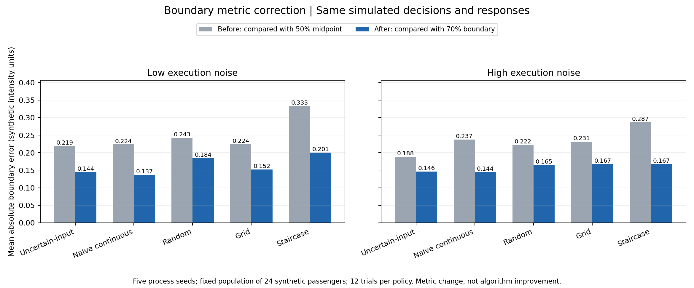

# Passenger motion-boundary calibration — synthetic simulation

本仓库保存乘客运动可接受边界研究中可独立复现的仿真代码、测试、合成数据、修正结果及研究设计说明。

**当前版本：2026-11-04 边界定义与误差指标修正。全部运行结果均来自合成乘客，真人研究尚未开展。**

## 本次修正

旧代码把接受概率为 50% 的 midpoint 当作真值，却评价 `tau=0.70` 的边界估计。现在根据生成器的噪声混合概率及每次试验的 carryover 计算一致的 B_tau，并用于误差、越界量、CSV 和图表。

选点、实测运动、反馈、评分和估计值保持不变；扩展版与 POC 的 3,780 条历史记录已逐条验证。五过程种子下，UncertainInputBO 和 NaiveContinuousBO 的修正误差接近，不能据此声称算法具有稳定优势。

- [完整修正报告与解释](docs/2026-11-04-boundary-correction-results.md)
- [仿真入口与字段说明](comfort_boundary_bo_research_package/simulation/README.md)
- [前后结果表](results/boundary_correction_20261104/multiseed_boundary_comparison.csv)



## 安装与运行

验证环境为 Python 3.12.7。建议在独立虚拟环境安装：

```bash
python -m pip install -r requirements-simulation.txt
python -m pytest -q
python comfort_boundary_bo_research_package/simulation/run_uncertain_input_bo_extended.py
python comfort_boundary_bo_research_package/simulation/run_uncertain_input_bo_poc.py
python long_horizon_audit/scripts/run_multiseed_simulation_audit.py --output-dir long_horizon_audit/derived/simulation_audit_corrected_20261104 --seeds 5
python comfort_boundary_bo_research_package/simulation/compare_boundary_results.py --baseline-root results/baseline_before_boundary_fix
```

前两个程序会重建各自的 CSV 和 PNG。审计程序输出五种子及敏感性场景汇总；比较程序验证旧合成轨迹保持一致，并生成前后对比表、PNG 和 JSON 验证记录。可直接打开已提交的结果查看。

本仓库的 `python -m pytest -q` 只发现已收录的仿真/比较/数据审计测试。完整本地研究文件夹另有依赖旧 Presentations 插件的 PPT 测试，该演示系统未收录；原工作区的该项环境失败在验证报告中单独说明。

## 目录

| 路径 | 内容 |
|---|---|
| `comfort_boundary_bo_research_package/simulation/` | 活跃仿真、比较程序及重建的合成结果 |
| `long_horizon_audit/scripts/` | 多种子仿真审计；可选的只读历史数据审计程序 |
| `long_horizon_audit/tests/` | 数学定义、回归、比较工具与合成数据审计测试 |
| `long_horizon_audit/derived/simulation_audit/` | 修正前历史审计快照 |
| `long_horizon_audit/derived/simulation_audit_corrected_20261104/` | 本次重新生成的审计结果 |
| `results/baseline_before_boundary_fix/` | 仅用于对照的旧合成 trial/summary CSV；不代表当前指标 |
| `results/boundary_correction_20261104/` | 前后比较、图表与轨迹一致性验证 |
| `docs/` | 本次修正/验证报告、执行计划、当前研究设计和研究定义 |

## 科学边界与后续工作

当前策略是 BO-inspired heuristic，不是严格的 uncertain-input GP-BO。仍需单独处理概率 surrogate/单调性、真实执行分布与算法认知分离、独立人群随机种子、grid 顺序和事件类型区分。本次修正不改变这些假设，也不验证车辆安全或真人有效性。

历史原始 VR/实车数据、参与者信息、第三方论文、内部论文草稿、旧 PPT、环境缓存和本地备份均未发布。数据审计测试自行构造虚拟 ZIP/XLSX，不需要任何真实参与者数据。实际数据审计程序只有在本地具备相应数据和授权时使用。

仓库中的研究设计是待执行方案；实际研究状态以证据记录为准。
