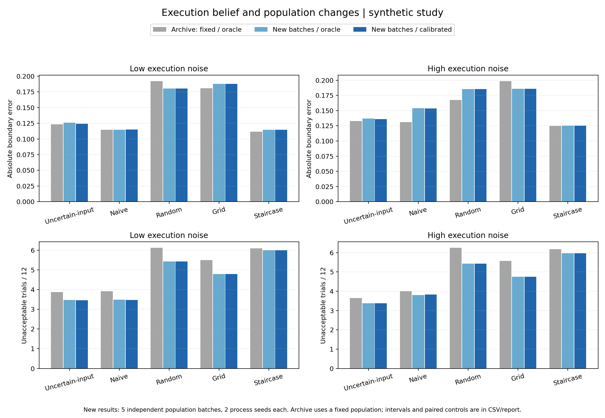

# Passenger motion-boundary calibration — synthetic simulation

本仓库保存乘客运动可接受边界研究中可复现的仿真代码、测试、合成结果及研究设计。

**当前版本：2026-11-04 执行分布与算法估计分离、独立人群验证。全部结果来自合成乘客，真人研究尚未开展。**

当前接受模型使用单调 Bernoulli–logistic 后验，输出 B_tau 中位数和可信区间。执行生成器与算法持有的分布现在是独立对象：默认算法仅由 40 条额外合成执行记录拟合偏差和噪声；`oracle` 明确表示已知真实参数的对照，`nominal` 表示固定假设。策略只能看到可观测历史，不能读取乘客真值或生成参数。

人群、过程、执行校准分别使用显式种子。新实验包含五批独立人群、每批两个过程种子，以及同过程的固定人群对照；按人群批次汇总区间，不把重复试验当成独立人群。另有未知执行偏差/低估噪声场景和上一版完整复现检查。

- [本次前后比较、解释与限制](docs/2026-11-04-execution-population-results.md)
- [本次验证记录](docs/2026-11-04-execution-population-verification.md)
- [历史：单调贝叶斯模型替换](docs/2026-11-04-monotone-bayes-results.md)
- [运行入口与数据字段](comfort_boundary_bo_research_package/simulation/README.md)
- [历史：边界定义修正](docs/2026-11-04-boundary-correction-results.md)



## 安装与复现

验证环境 Python 3.12.7；建议使用独立虚拟环境。

```bash
python -m pip install -r requirements-simulation.txt
python -m pytest -q
python comfort_boundary_bo_research_package/simulation/run_uncertain_input_bo_extended.py
python comfort_boundary_bo_research_package/simulation/run_uncertain_input_bo_poc.py
python long_horizon_audit/scripts/run_execution_population_audit.py
python long_horizon_audit/scripts/compare_execution_population.py
```

前两个入口默认写入 `outputs_execution_separated/` 和 `outputs_execution_separated_poc/`；同一固定人群用于单次运行示例，可用 `--population-seed` 指定另一个种子。人群审计默认运行 85 个场景；可分别用 `--suite historical|fixed_control|population|stress` 运行，四组完成后再执行比较。每组保存参数清单、个体/策略汇总、人群参数和校准观测。校准的 40 次额外合成执行不含乘客反馈，与每人 12 次反馈预算分开计算。

旧结果保留。历史 kernel 重跑须显式使用 `--surrogate legacy_kernel --execution-belief oracle`；上一版 Bayesian 重跑使用 `--surrogate monotone_bayes --execution-belief oracle`。历史审计入口 `run_multiseed_simulation_audit.py` 默认仍为 oracle/固定人群。旧比较脚本继续读取旧快照：

```bash
python comfort_boundary_bo_research_package/simulation/compare_boundary_results.py --baseline-root results/baseline_before_boundary_fix
python comfort_boundary_bo_research_package/simulation/compare_surrogates.py
```

## 目录与研究范围

| 路径 | 内容 |
|---|---|
| `comfort_boundary_bo_research_package/simulation/` | 新旧模型、仿真入口和结果 |
| `long_horizon_audit/scripts/` | 多种子仿真及可选历史数据审计 |
| `long_horizon_audit/tests/` | 数学、回归、模型和比较测试 |
| `long_horizon_audit/derived/execution_population_20261104/` | 85 场景的配置、校准、人群及指标 |
| `results/execution_population_20261104/` | 按人群聚类的区间、配对影响和最新图表 |
| `long_horizon_audit/derived/simulation_audit_bayesian_20261104/` | 新模型五种子和敏感性结果 |
| `long_horizon_audit/derived/simulation_audit_legacy_comparison_20261104/` | 旧模型重跑，新增 Brier 指标 |
| `results/monotone_bayes_20261104/` | 新旧配对比较、数值验证、覆盖率和图表 |
| `results/boundary_correction_20261104/` | 上一轮边界指标修正的历史比较 |
| `docs/` | 当前及历史报告、研究设计、执行计划 |

选点仍是 BO-inspired heuristic，未实现信息增益最优化或 SafeOpt 保证。执行估计仍假定已知函数结构，只拟合偏差和公共噪声尺度；未传播执行参数估计不确定性，也未在线更新。后续可检验更广的执行模型失配、反馈 lapse/时间效应及选点规则。五批合成人群的区间仍有限，不能证明实车安全或真人有效性。

历史原始 VR/实车数据、参与者信息、第三方论文、内部论文草稿、旧 PPT、环境缓存和备份均未发布。数据审计测试自行构造虚拟 ZIP/XLSX，不依赖实车资源。完整本地研究文件夹另有旧 Presentations 运行时测试，该演示系统未收录，本仓库测试范围见 `pytest.ini`。
