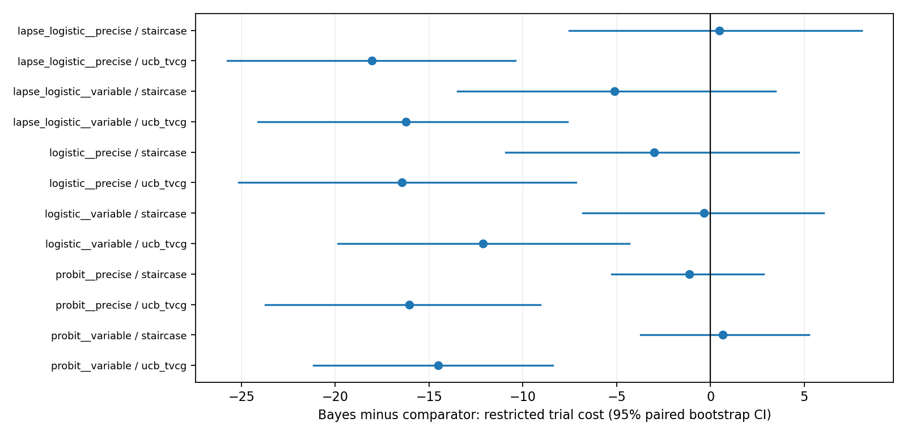
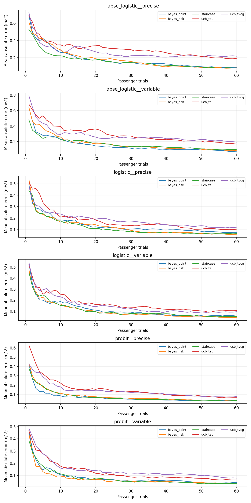
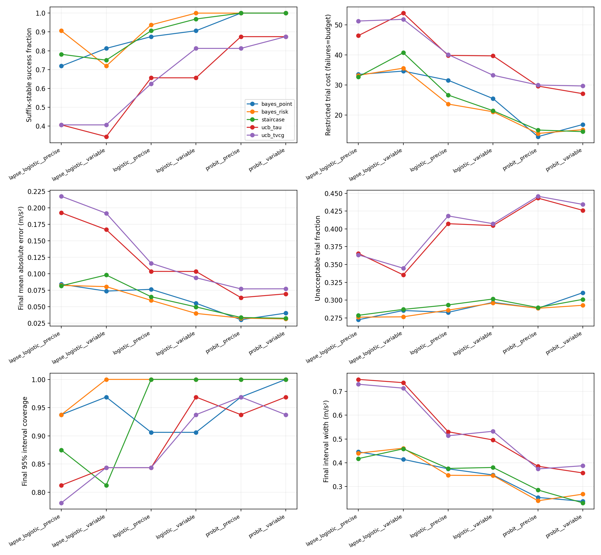

# 独立乘客、实测加速度边界的模拟比较

## 研究问题与证据边界

比较的是不同采样器在共同估计器下，为每个模拟乘客估计一维实测加速度可接受性上边界 B_tau 的采样效率；不是最大舒适点优化，不是车辆控制，也不是人体方法优劣证据。Bayesian 方法是否获胜不是实施验收条件。主比较为 bayes_risk 对原始奖励形态的 ucb_tvcg、criterion-targeted staircase；bayes_point 是执行不确定性消融，ucb_tau 是拒绝惩罚的次要敏感性分析。

## 冻结设置与重复单位

冻结文件为 configs/decoupled_heldout.json，held-out 种子271828；开发pilot用于运行预算估计，未作为本文最终数据。三类反应曲线 logistic、probit、lapse_logistic × 两类执行情境 precise、variable，共六情境。每类32个独立乘客参数集，跨执行条件复用同一乘客，因此是96个独立乘客、192个乘客条件组合，五方法产生960个参与者方法记录和57,600个反馈试次，不能将192个组合称为192个独立人，也不能把57,600个逐试次行当作独立重复。

每方法预算60，checkpoint10/20/40/60；公共命令域[0,3] m/s²，31个等间隔命令。tau=.70为合成操作标准，delta=.15 m/s²为域宽5%，均不是经过人体验证的舒适或安全阈值。先验沿用历史 MonotoneBayesianLogistic，midpoint/log-slope网格81×41，执行积分7节点。边界均匀分布[.5,2.5]；斜率lognormal(log4,.35)，lapse族对称lapse=.10。precise执行为截距0、增益1、SD=.03；variable为截距.08、增益.92、SD=.18，执行值截在[0,3]。

每乘客条件使用90次独立执行标定，估计仿射执行模型及残差SD；90次标定不计入反馈试次数，但总计17,280次标定测量应另报。执行belief是点估计，采样决策未传播其标定参数不确定性。后验推断在已测得的realized x上条件化，不是永久潜在输入似然；不能笼统宣称整合了全部执行不确定性。

主要终点：首个t>=10，且从t到预算末端至少5个估计、整个后缀均在delta内。主成本对事件取t，对未达标取60；这是预算限制成本，不是成功者均值，也不是预算外收敛时间的估计。此主要终点事后回看未来轨迹，不能直接用于在线停止。次要终点是t>=10首次出现以t结尾的连续5个准确估计。每情境内按32个乘客配对bootstrap2000次，种子314159，给Bayes减比较方法的均值差及百分位95%区间；不跨情境混池、不将顺序试次当独立样本，区间未做多重比较校正。

## 结果：相对staircase和消融的证据并不明确

**不能据本次结果宣称Bayes普遍优于其他方法。** 相比staircase，六情境主成本配对95%区间全部跨零；lapse/precise及probit/variable的Bayes成本点估计反而更高。lapse/variable中Bayes主成功率23/32，低于staircase的24/32；Bayes高估超过delta的比例4/32，高于staircase的2/32。lapse/precise最终MAE为.0823，略高于staircase的.0818。

主成本对原始奖励形态ucb_tvcg的差值六情境均为负，配对区间均不跨零；相应最终误差和不可接受反馈比例的差值区间也均低于零。这仅支持本冻结模拟设置下的采样比较，不可归因为原TVCG整套系统劣效，也不能外推人体优势。

| 情境 | Bayes主成本 | TVCG-UCB主成本 | Staircase主成本 | Bayes−TVCG-UCB [95% CI] | Bayes−Staircase [95% CI] |
|---|---:|---:|---:|---:|---:|
| lapse_logistic__precise | 33.22 | 51.25 | 32.75 | -18.03 [-25.75, -10.41] | 0.47 [-7.53, 8.06] |
| lapse_logistic__variable | 35.59 | 51.81 | 40.72 | -16.22 [-24.13, -7.62] | -5.12 [-13.47, 3.47] |
| logistic__precise | 23.69 | 40.12 | 26.69 | -16.44 [-25.16, -7.16] | -3.00 [-10.91, 4.72] |
| logistic__variable | 21.12 | 33.25 | 21.47 | -12.12 [-19.85, -4.31] | -0.34 [-6.81, 6.03] |
| probit__precise | 13.94 | 30.00 | 15.06 | -16.06 [-23.72, -9.06] | -1.12 [-5.25, 2.84] |
| probit__variable | 15.19 | 29.69 | 14.53 | -14.50 [-21.16, -8.41] | 0.66 [-3.72, 5.25] |

下表每格为“主成功人数/32；主删失人数；末次95%区间覆盖率”。成功与删失都保留；后验区间宽度与覆盖率必须联合解读，覆盖高于名义95%也可能反映保守性。

| 情境 | Bayes | TVCG-UCB | Staircase |
|---|---:|---:|---:|
| lapse_logistic__precise | 29/32；3；93.8% | 13/32；19；78.1% | 25/32；7；87.5% |
| lapse_logistic__variable | 23/32；9；100.0% | 13/32；19；84.4% | 24/32；8；81.2% |
| logistic__precise | 30/32；2；100.0% | 20/32；12；84.4% | 29/32；3；100.0% |
| logistic__variable | 32/32；0；100.0% | 26/32；6；93.8% | 31/32；1；100.0% |
| probit__precise | 32/32；0；100.0% | 26/32；6；96.9% | 32/32；0；100.0% |
| probit__variable | 32/32；0；100.0% | 28/32；4；93.8% | 32/32；0；100.0% |

Bayes末次区间宽度均值随情境为.240–.461 m/s²，TVCG-UCB为.374–.730，staircase为.231–.459；Bayes并非每格最窄（例如probit/variable .268，对staircase .231），高覆盖也不等于最有效率。主运行全部960个参与者方法记录的out_of_domain和unidentifiable标志均为0；这不代表未达可靠精度的删失记录不存在。Bayes仍有lapse/variable9/32未达主事件。

**消融（bayes_point）**：Bayes风险积分与均值输入的六个主成本差区间全部跨零；lapse/variable差+.97 [−6.84,8.50]，probit/precise差+1.06 [−2.13,4.50]，点估计不利。因而本次不能主张建模执行分散必然提高效率；probit/variable不可接受反馈比例差−.0177 [−.0292,−.0068]是局部有利结果，并非整体成本证据。

**次要敏感性（ucb_tau）**：Bayes主成本差六情境均为负且区间低于零，范围−18.56至−11.94试次；该结果单独保存在次要比较中，不取代原奖励主比较。lapse/variable不可接受比例差区间含零，仍不能把所有指标概括成一致优势。







完整30行方法情境汇总及所有效应见[scenario_summary.csv](../../results/decoupled_calibration_20261105/analysis/scenario_summary.csv)、[paired_effects.csv](../../results/decoupled_calibration_20261105/analysis/paired_effects.csv)；逐试次均值、覆盖、支持和edge mass见[trajectories.csv](../../results/decoupled_calibration_20261105/analysis/trajectories.csv)。所有区间均为情境内参与者级、未校正的描述性不确定性，未执行跨情境独立性假设或显著性胜负计数。

## 数值检查、方法来源与解释限制

开发期固定公共belief(intercept=.08,gain=.96,SD=.25)，比较7与15节点执行积分；81×41参数网格、31公共命令、tau=.7，无比较结果参与选择。固定实测历史为空、[(.3,1),(.9,1),(1.5,0),(2.1,0)]、[(.6,1),(1.2,1),(1.8,1),(2.4,0),(1.6,0),(1.4,1)]；全部历史命令记为1.5。三组7/15节点都选1.0/.9/1.2，整个命令网格最大acquisition差分别8.81e-4、9.56e-5、4.46e-5。这只是局部数值一致性检查，不能保证所有历史/噪声条件选择不变；保留预定7节点，未按方法胜负调整。

Bayes acquisition在未来实测x的每个积分节点上先计算二元反馈后的边界方差，再对x平均；稳定实现Cov(B,p)^2/[q(1-q)]已与小网格逐后验枚举核对。实现借鉴[Kontsevich与Tyler1999](https://www.psychophysics.ethz.ch/Downloads/protected/Kontsevich.pdf)的联合阈值/斜率自适应推断思想，以及[Oliveira等2019](https://proceedings.mlr.press/v89/oliveira19a.html)的输入执行不确定性问题；不是原论文uGP-UCB复现。staircase采用[Kaernbach1991](https://link.springer.com/content/pdf/10.3758/BF03214307.pdf)式加权上下步长思想以匹配tau，有限网格和执行噪声仍会改变其命令域行为。

[TVCG原文](https://doi.org/10.1109/TVCG.2021.3057797)与原始源代码审计保留epsilon/Q/count bonus及历史多数表决（只作用Q奖励，后验仍用原始答案），主UCB用±归一化强度；c从原尺度2同步缩为.2。原17个不均匀gain动作改为共同31命令，原35试次后15次稳定best-action停止改为共同预算，不能称为整套原系统复现。次要ucb_tau改变拒绝代价；两种UCB奖励目标均不等同于B_tau。详见[方法审计](decoupled_algorithms.md)。

logistic/probit的相同数值斜率k不表示tau处导数相同，因此跨族差异混合了曲线形状与有效陡峭度，不可全归因于似然失配。lapse改变给定tau的真实交点，生成器已显式解出正确B_tau。先验/参数网格/反应模型失配会影响区间覆盖，较窄区间不代表可信度更高。共享报告估计器控制了估计器差异，但不能消除各采样器数据分布差异或模型错误。Bayes及共同单调模型、staircase利用了强度有序与单调结构，而来源UCB把动作视为不共享信息的臂；因此对UCB的优势不能单独归因于“贝叶斯”机制或执行不确定性感知。全接受/全拒绝、边界域外及支持不足不被静默删除；主生成区间本身在域内，域外正确性另有测试，不能声称本held-out已覆盖域外乘客。

后续BO-only人体可行性与独立验证方案见[人体研究交接](decoupled_human_handoff_zh.md)，不能据此推论人体比较优势。

另有独立开发种子的域外压力诊断：[stress_summary.md](../../results/decoupled_calibration_20261105/stress/stress_summary.md)，边界固定-.5和3.5，20个参与者方法记录、600反馈试次，全部标记out_of_domain与unidentifiable，报告估计不截到域内。它不是held-out主比较的一部分，既不混池，也不把域外测试当作有效辨识域外边界的证据。


## 复现与后处理来源

运行原始数据由固定配置生成，分析命令为：

```powershell
python -m comfort_boundary_bo_research_package.simulation.decoupled_calibration.analysis --input results/decoupled_calibration_20261105/raw --output results/decoupled_calibration_20261105/analysis
```

配置规范文本SHA256为`3569435c4f847c1dd17831aea6cded423f4019e963f55b788e1284e06cd80b2e`。Windows输出换行使磁盘config.json字节SHA不同（`127062fd0530e7e6e6c3bf1cf11611d381bd2bb8187076aed4ca6735dab58cdd`）；两者分别代表规范LF配置文本及实际文件字节，不是两套配置。原始trial字节SHA为`e73051e41c47b96c7d7955da2c8164fa71508937e59bd1e463233817c836483f`，参与者表为`15ba8345083ea9bcbda153793faf9e174ce45f47ff9260fafe41ce3b8dddea67`。

后处理源analysis.py SHA为`b5026814146c7d58d439434933e0c4836ed9187f41c291bcdb6e473f4d55ffe8`；其独立[postprocessing_manifest.json](../../results/decoupled_calibration_20261105/analysis/postprocessing_manifest.json)记录输入哈希、bootstrap设置及图表CSV映射。采样科学源、先验和有效参数哈希在raw/effective_parameters.json中单独冻结。后处理演化不应被误称为重新调节采样器；最终结果仅来自这一轮冻结held-out运行。
