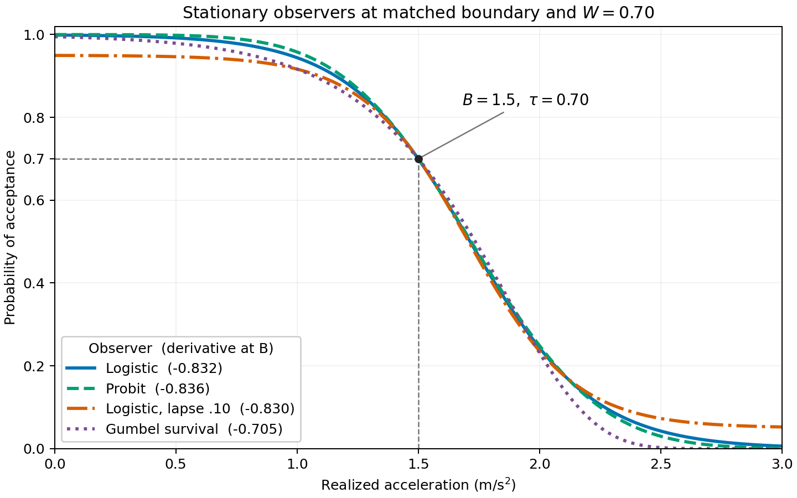

# 静态模拟被试外部验证与独立有限预算复现

本轮保留了经核验正确的原三种静态观察者，只增加一种有外部依据的非对称曲线。256组新基础参数的主批次中，BO在N30仅一个场景达到成功率证据标准，该场景的A/B层成功率优势也通过六场景校正；六条件总体次要分析显示N30平均收益。N60原六条件分别通过目标，但新增Gumbel与宽过渡条件没有同样保证。这些是合成模型条件下的结论，尚无真人效度证据。

## 本轮验证了什么

保留原有logistic、probit及偶发随机回答logistic实现，只加入一种预先选定方向的Gumbel生存函数。原BO/UCB/阶梯选点、先验、读出、执行估计和90次执行校准均未修改；12个受保护科学模块与旧版字节一致。新旧批次的点率变化属于独立Monte Carlo复现差异，不能称为算法又获得改善。

文献与软件支持的是二元心理测量曲线、Bernoulli回答及相关分布形式，不是本项目乘客人群的实测参数。B∼Uniform(.5,2.5)、W的对数正态分布（中位数.70、对数标准差.35）、总随机回答概率.10、执行情境均仍是仿真假设。详见[原始论文、固定代码版本和证据分级](../../docs/observer-validation-sources-20261107.md)。lambda=.10表示10%概率改为均匀随机二元回答，渐近值为.05/.95；不是10%回答翻转率。

还有一项需要公开的模型对齐：推断模型仍为logistic。主logistic人群W中位数.70对应k中位数约3.96，接近先验log(k)中心log(4)；先验log标准差.70，人群对应的log(k)标准差.35。B的生成范围[.5,2.5]在测试域[0,3]内部，边界先验中心和阶梯起点均为1.5。因此公式正确并不意味着基准对所有算法中立或代表真实人群。共同读出让阶梯/UCB共享最终模型，但BO也用先验决定选点；Gumbel和宽度敏感性只覆盖有限失配，不能排除所有建模偏向。本轮没有据此重新调先验或选择更有利的人群。

59项确定性检查及20个条件各100000次生产respond调用（共200万次）通过预设核验。独立SciPy参照与生产概率最大差2.22e−16；均值及不重叠相邻乘积最大偏差分别2.463、1.735个标准误，阈值固定为6。极小尾概率不能靠零次成功充分核验，尾部依据主要来自确定性分布对照。这说明程序符合指定模型，不等于验证真人反应或所有滞后下的独立性。

图中B=1.5、W=.70、目标接受概率=.70；对应局部导数为logistic−.8318、probit−.8361、lapse=.10的logistic−.8303、Gumbel−.7047，单位(m/s²)⁻¹。匹配边界和.8到.2的物理宽度并没有匹配所有信息特征；Gumbel在边界处相对logistic约平缓15.3%，尾部偏斜也不同。它使用gumbel_l的生存函数，方向在结果前固定，不能根据输赢挑选反射。

## 固定新样本、预算与两层比较

主批次为256组新B/W参数，跨原六场景复用；探索批次的四个logistic/Gumbel条件共享64组新参数，窄/宽W条件各另有64组，合计192组独立B/W。探索logistic基线不是主批次的子集。采样方法均为new_precision、staircase和TVCG衍生UCB，每条轨迹固定60次。

|批次|合成反馈|另计执行校准|实际运行耗时|
|---|---:|---:|---:|
|正式主批次|276480|46080|1002.46秒|
|探索批次|69120|23040|273.23秒|
|仅用于耗时的试跑|6480|1080|26.36秒|

正式合计345600次合成反馈、69120次合成执行校准；上述耗时不包括后处理核验，200万次观察者单元审计另计。全部样本数、种子及统计规则在运行前固定的协议提交054171f保存。这是新结果产生前的Git记录，并非OSF等外部注册平台登记；新结果没有用于加样本、换种子或调整模型。历史128组数据只用于事前波动和耗时规划，没有和新样本混合推断。

目标仍为B_.70，N30主终点、N60次要终点、δ=.15 m/s²、成功率目标80%。支持成功要求数值正常、出现接受和拒绝、估计在实际观测范围内且误差≤δ；全部参与者都保留在分母。A层比较BO自身读出与阶梯Firth完整流程；B层对各采样历史使用同一个冻结v2贝叶斯读出。BO在A/B两层输出相同，两层不是两次独立复现。

## 原六场景：N30结果及目标达标

|场景|BO（冻结v2，A/B）|阶梯＋Firth（A）|阶梯＋共同读出（B）|UCB＋共同读出（B）|
|---|---:|---:|---:|---:|
|logistic_precise|80.9%|75.4%|79.3%|59.8%|
|logistic_variable|79.7%|75.0%|80.9%|59.4%|
|probit_precise|83.6%|77.0%|79.7%|58.2%|
|probit_variable|82.0%|78.9%|80.1%|66.0%|
|lapse_logistic_precise|85.9%|75.0%|77.0%|54.3%|
|lapse_logistic_variable|79.3%|71.5%|75.4%|47.3%|

UCB只作为预设描述性参照；这不是对原TVCG系统或所有UCB方法的评价，也未追加事后优越性检验。

|场景|BO N30成功率 [95% Wilson]|N30 MAE / P90（m/s²）|BO N60成功率 [95% Wilson]|
|---|---:|---:|---:|
|logistic_precise|80.9% [75.6, 85.2]|0.091 / 0.189|93.0% [89.2, 95.5]|
|logistic_variable|79.7% [74.3, 84.2]|0.094 / 0.190|91.0% [86.9, 93.9]|
|probit_precise|83.6% [78.6, 87.6]|0.088 / 0.198|92.6% [88.7, 95.2]|
|probit_variable|82.0% [76.9, 86.2]|0.091 / 0.190|93.0% [89.2, 95.5]|
|lapse_logistic_precise|85.9% [81.1, 89.7]|0.080 / 0.170|91.0% [86.9, 93.9]|
|lapse_logistic_variable|79.3% [73.9, 83.8]|0.098 / 0.216|89.1% [84.6, 92.3]|

按逐场景Wilson下限≥80%的预设标准，N30只有lapse_logistic_precise通过，其余五场景证据不足；N60原六场景分别通过。这不是六场景联合95%保证，N60也不替换N30主目标。MAE/P90是有限数值输出条件下的误差，须同时看支持与失败情况。

## 预设场景内配对比较

下表为N30BO（冻结v2）减阶梯的成功率差（百分点），方括号为每层六场景Bonferroni99.1667%配对bootstrap区间。校正只覆盖同一层、同一指标的六场景，不是所有层、预算和指标的全局校正。

|场景|A层：BO−Firth|B层：BO−阶梯共同读出|
|---|---:|---:|
|logistic_precise|+5.47 [-3.52, +14.06]|+1.56 [-6.90, +10.16]|
|logistic_variable|+4.69 [-3.91, +13.28]|-1.17 [-9.77, +7.42]|
|probit_precise|+6.64 [-1.95, +15.23]|+3.91 [-4.30, +12.50]|
|probit_variable|+3.12 [-5.47, +11.72]|+1.95 [-6.64, +10.94]|
|lapse_logistic_precise|+10.94 [+1.95, +19.92]|+8.98 [+0.39, +17.58]|
|lapse_logistic_variable|+7.81 [-1.95, +17.58]|+3.91 [-5.34, +13.28]|

本次新样本中，只有lapse_logistic_precise的A/B层成功率差在各自六场景校正后仍高于零；其余五场景均不排除零，不能据点差宣称稳定优胜或等效。A/B共享BO读出，并非两次独立复现。

封顶误差的次要比较还显示：A层lapse_logistic_precise差−.0453，校正区间[−.0852,−.0149]；A层lapse_logistic_variable差−.0393，[−.0812,−.0065]；B层lapse_logistic_precise差−.0239，[−.0445,−.0049]。其余误差区间包含零。旧批次logistic_precise的特定误差优势没有在本批次通过相同校正，说明不宜把一次模拟的单场景发现当作普遍规律。

## 六场景等权总体：新增预设次要分析

每名基础参与者先对六场景的BO减阶梯差值取等权均值，再整组重抽256名基础参与者，20000次bootstrap。1536个条件案例不能当作1536名独立参与者。下表区间均为未做全局多重校正的95%区间，八个总体区间不是一组联合保证，也不能覆盖或替换原六场景主比较。

|预算／层|成功率差（百分点）[95%区间]|封顶绝对误差差（m/s²）[95%区间]|
|---|---:|---:|
|N30／A|+6.45 [+3.45, +9.38]|-0.02830 [-0.03917, -0.01832]|
|N30／B|+3.19 [+0.39, +5.99]|-0.00876 [-0.01492, -0.00257]|
|N60／A|+1.89 [-0.07, +3.91]|-0.00505 [-0.01020, -0.00035]|
|N60／B|-0.13 [-2.08, +1.82]|+0.00001 [-0.00391, +0.00391]|

N30总体点率为BO81.90%、Firth75.46%、阶梯共同读出78.71%；两层总体成功率差的预设次要95%区间均高于零，支持这六个条件等权混合下的有限预算平均收益。B层收益小于完整流程A层，完整流程差异不能全部归于选点。

N60总体点率为BO91.60%、Firth89.71%、阶梯共同读出91.73%；成功率差区间均包含零。A层仍有约.0051 m/s²的较小平均封顶误差降低，B层误差差接近零且区间跨零。两种阶梯读出在N60也都逐场景达到Wilson下限80%标准；不能把N60可行性说成BO独有优势。此处没有测得更少的真实停止次数。

## 匹配曲线与宽度探索

下表为另一个预设64人/条件批次。四个形状条件B/W及执行校准严格配对，回答随机流仍按场景分开；窄/宽条件各有独立人群，只作条件级敏感性描述。整个探索族不进入原六场景校正主分析。探索批次N30的12个A/B成功率差95%区间均包含零；这些未校正探索区间也不承担主比较的角色。

|探索场景|BO N30|Firth N30|阶梯共同读出 N30|UCB共同读出 N30|BO N60 [95% Wilson]|
|---|---:|---:|---:|---:|---:|
|logistic_precise|73.4%|75.0%|75.0%|62.5%|87.5% [77.2, 93.5]|
|logistic_variable|81.2%|71.9%|76.6%|56.2%|96.9% [89.3, 99.1]|
|gumbel_precise|78.1%|68.8%|79.7%|65.6%|87.5% [77.2, 93.5]|
|gumbel_variable|76.6%|62.5%|65.6%|51.6%|79.7% [68.3, 87.7]|
|width_narrow_variable|95.3%|96.9%|96.9%|76.6%|100.0% [94.3, 100.0]|
|width_wide_variable|54.7%|57.8%|64.1%|56.2%|67.2% [55.0, 77.4]|

同一匹配人群下，Gumbel相对logistic的BO成功率点差在N30为精确执行+4.7、波动执行−4.7个百分点；N60分别为0与−17.2个百分点。这些仅是预先限定的描述性差异，没有追加显著性检验，不能称为精确的形状因果效应。Gumbel两种执行条件即使在N60也未达到Wilson下限80%的证据标准，因此原六条件N60通过不能外推为任意静态曲线都通过。

宽W条件中BO N30只有54.7%，N60为67.2%；窄W条件则为95.3%与100%。这是不同人群组的条件描述，不是同一人的配对宽度变化。过渡宽度仍是可行性的关键限制；本轮没有选择更有利的宽度来代替主结果。历史lapse=.20压力保留为旧探索证据，新批次没有重复运行；其概率构造另有独立确定性核验。

## 失败、可支持的表述与下一步

主批次及探索批次的N30/N60指定读出均无数值失败，但“有限数值”不等于有数据支持。主批次N30按1536个条件案例计算，Firth有33个不受观测支持的输出，阶梯共同读出2个、UCB共同读出3个、BO为0；N60分别为7、0、0、0。探索N30按384个条件案例计算，相应数量为12、0、2、0；N60为2、0、0、0。这些都保留在分母。有限但不受支持的估计仍使用其封顶误差，只有非有限输出自动赋误差3。完整失败、边界约束和域外输出见每批次applicability_failures.jsonl。

可以支持的研究表述是：有来源依据、经过独立数值核验的静态合成人框架，在冻结算法和新样本中复现了原六条件下60次预算的逐条件可行性；30次总体平均比较显示有限收益，并有一个原主条件的校正后成功率优势。它没有证明原六条件30次均满足目标、所有静态曲线60次均满足目标，或真人中稳定优于阶梯。

本轮仍是固定状态、独立逐次Bernoulli回答，实际加速度被准确观测；没有疲劳、学习、持续注意状态或新的传感器误差。后验停止回放不改变固定预算结果，也不能把模型自报90%窗口概率当成真人90%正确保证。

下一步首先用小规模真人预试辨认单调性、宽度、重复回答和顺序变化，再用独立数据验证算法；不能把有限参考测量当作无误差真值。具体最小预试建议及限制见[来源审计中的真人预试协议](../../docs/observer-validation-sources-20261107.md#后续最小真人预试用于辨认假设不作方法优越性验证)。本项目目前没有A级“本任务真人实证”参数，仿真可行性不能替代人体效度或实车安全证据。

## 工件与恢复

- [固定协议与样本规划](../../docs/superpowers/specs/2026-11-07-observer-validation-design.md)、[运行前协议指纹](../../results/observer_validation_20261107/preregistration.json)、[正式抽样前核对](../../results/observer_validation_20261107/before_sampling_audit.json)。
- [观察者审计](../../results/observer_validation_20261107/observer_validation.json)、[主场景全表](../../results/observer_validation_20261107/main_analysis/report_zh.md)、[整体配对区间](../../results/observer_validation_20261107/cluster_analysis/clustered_effects.jsonl)、[探索全表](../../results/observer_validation_20261107/exploratory_analysis/report_zh.md)。
- [复现命令与字段解释](observer_validation_reproducibility.md)、[验证记录](../../docs/2026-11-07-observer-validation-verification.md)、[版本保存点与恢复步骤](../../docs/version-checkpoints.md)。

正式两批次的独立原始核验均通过；全部92160条读出、645120个字段均从历史前缀重建一致，各有1条完整60反馈轨迹精确回放。报告中的24条主配对记录、96条固定预算记录及8条总体区间已与正式工件逐字段核对，见[报告数据核对](../../results/observer_validation_20261107/report_data_audit.json)。来源、冻结、原始输入与审计载荷的最终核对见[发布完整性记录](../../results/observer_validation_20261107/release_integrity_audit.json)。旧v1/v2工作树和标签保持原提交；715份旧发布文件在本轮授权修改范围之外保持原字节，见[保留核对](../../results/observer_validation_20261107/legacy_preservation_audit.json)。
