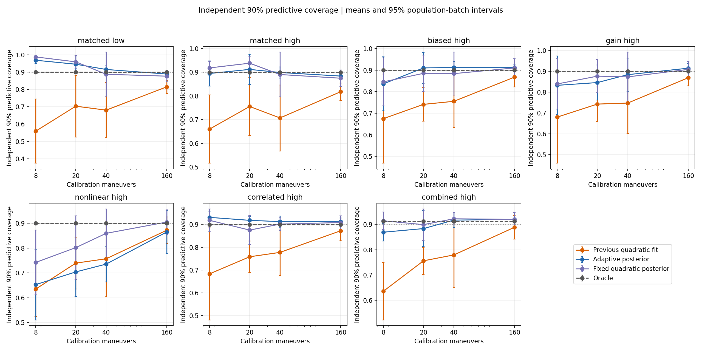
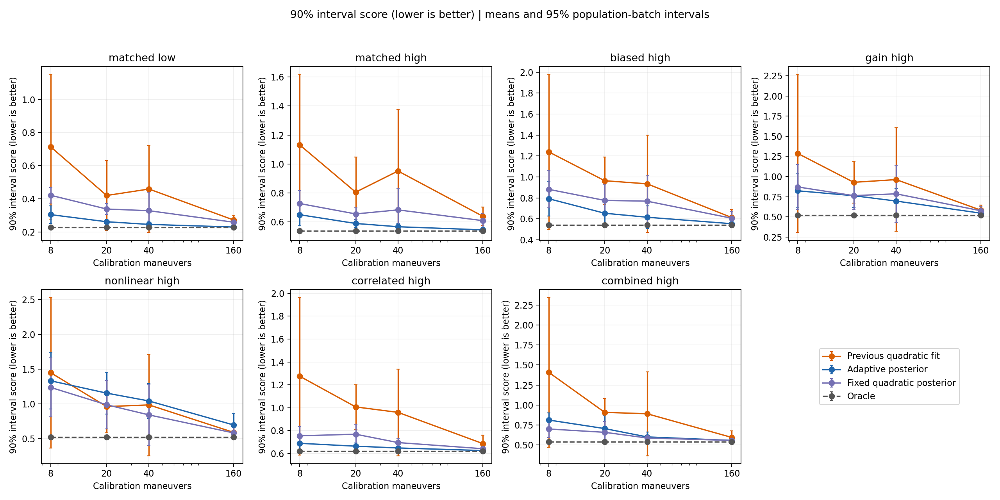

# 小校准预算下的模型选择、后验预测与前后对比

新增模型对仅偏差、线性增益、二次曲率三个单调执行模型做贝叶斯模型平均，并把模型选择、均值参数和完整协方差的不确定性传播到未来执行预测。它减轻了简单真实模型和相关噪声条件下的过拟合及漏覆盖，但会在曲率证据不足时欠拟合；目前不能称为对前版的全面替代。

基线是 `33e0123` 的固定二次均值＋完整协方差点估计。七类真实执行条件×四档预算×五批独立人群×两次过程重复，共 280 个新场景和 280 个前版重放场景；新旧逐值共享校准记录与成对过程流。每场景 24 人×5 策略×12 次反馈。六种预测方式还产生 35,280 行执行诊断。方法、固定先验和复现入口见[方法说明](2026-11-04-adaptive-execution-method.md)，精确重放与发布核验见[验证记录](2026-11-04-adaptive-execution-verification.md)。

## 8 次校准：简单场景改善，真实曲率仍难识别

下表为校准范围之外八个命令点的均值。覆盖率以独立真实未来样本计算，名义目标为 90%；旧列也用相同新评估方法重新计算，故与上一轮共享创新样本的覆盖率有小幅数值差别。

| 真实条件 | 外推强度均值绝对误差：旧→新 | 90% 预测区间覆盖率：旧→新 |
|---|---|---|
| 匹配低噪声 | 0.0759 → 0.0250 | 55.9% → 96.8% |
| 匹配高噪声 | 0.1315 → 0.0633 | 66.0% → 89.5% |
| 未知偏差 | 0.1269 → 0.1106 | 67.5% → 83.6% |
| 增益失配 | 0.1254 → 0.1213 | 68.1% → 83.3% |
| 二次非线性 | 0.1493 → 0.1979 | 63.5% → 65.3% |
| 相关噪声 | 0.1267 → 0.0350 | 68.3% → 93.1% |
| 组合失配 | 0.1440 → 0.1366 | 63.6% → 86.9% |

匹配低噪声、匹配高噪声、相关噪声的外推均值误差分别下降约 67%、52%、72%，对应配对 95% 区间均未跨过 0。覆盖率增量在这三类及增益、组合条件下的配对区间未跨过 0；偏差和纯非线性条件仍不确定。每个区间只有五个独立批次，且未校正多重比较，不应理解为普遍保证。

减轻拟合噪声的迹象也出现在训练/外推的反向变化：匹配高噪声下，训练加速度均值 RMSE 从 0.0902 升至 0.0981，外推强度均值误差却从 0.1315 降至 0.0633；相关噪声下分别为 0.0961→0.1189、0.1267→0.0350。这里是两个不同目标的诊断，不把两者相减构造所谓泛化误差。

纯非线性相反：8 次校准时误差 0.1493→0.1979，覆盖率仅 63.5%→65.3%。三种候选中虽然包含正确的二次函数，但中央 60% 命令范围的少量噪声观测不能稳定识别曲率，先验与复杂度惩罚会把预测拉向较简单模型。

## 区间变宽有没有付出代价

以下同时给出区间宽度和适当区间评分；评分越低越好，既惩罚过宽，也惩罚漏覆盖。均为 8 次校准的外推区均值。

| 真实条件 | 区间宽度：旧→新 | 区间评分：旧→新 | oracle 评分 |
|---|---|---|---|
| 匹配低噪声 | 0.184 → 0.288 | 0.714 → 0.304 | 0.226 |
| 匹配高噪声 | 0.431 → 0.509 | 1.132 → 0.650 | 0.538 |
| 未知偏差 | 0.449 → 0.540 | 1.239 → 0.793 | 0.541 |
| 增益失配 | 0.426 → 0.552 | 1.287 → 0.824 | 0.523 |
| 二次非线性 | 0.447 → 0.546 | 1.447 → 1.331 | 0.522 |
| 相关噪声 | 0.494 → 0.597 | 1.275 → 0.689 | 0.621 |
| 组合失配 | 0.463 → 0.622 | 1.408 → 0.811 | 0.540 |

七类的平均评分均低于旧点估计，但七个评分变化的配对 95% 区间全部跨过 0。可以报告当前样本的平均改善，尚不能宣称小预算下评分稳定优于前版。新模型也没有达到 oracle 的预测质量。

低噪声覆盖率 96.8% 明显偏保守。六种预测方式的消融说明，收益并非全部来自传播更多不确定性：

- 在相同新后验下，低噪声自适应点预测的覆盖率/评分为 89.8%/0.260；传播参数和模型不确定性后为 96.8%/0.304，覆盖升高但评分变差。固定二次后验更宽，覆盖 98.7%、评分 0.421；复杂度选择缓解了这种过度保守。
- 匹配高噪声下，自适应点预测为 80.0%/0.668，完整传播后为 89.5%/0.650，平均覆盖和评分同时改善。
- 纯非线性下，固定二次后验为 74.2%/1.235，自适应后验为 65.3%/1.331；组合失配下分别为 91.4%/0.699 与 86.9%/0.811。复杂度选择在这两个小预算条件下付出了欠拟合代价。
- 相关噪声下，自适应点预测 88.2%/0.685，完整传播 93.1%/0.689；传播的平均评分收益并不成立。

上述是执行分布层的受控消融。旧版到新版还改变了先验与协方差推断方法，且没有跑六种方式各自的完整反馈策略，不能把最终边界收益单独归因于模型选择或参数传播。

## 增加校准预算后怎样变化

新模型外推区覆盖率如下；理想值约为 90%，存在物理裁剪原子时 oracle 的中央区间也可能高于 90%（组合条件约 91.2%）。

| 真实条件 | 8 次 | 20 次 | 40 次 | 160 次 |
|---|---|---|---|---|
| 匹配低噪声 | 96.8% | 94.5% | 91.5% | 88.9% |
| 匹配高噪声 | 89.5% | 91.2% | 89.9% | 88.4% |
| 未知偏差 | 83.6% | 91.0% | 91.2% | 91.2% |
| 增益失配 | 83.3% | 84.6% | 88.4% | 91.5% |
| 二次非线性 | 65.3% | 70.4% | 73.5% | 86.5% |
| 相关噪声 | 93.1% | 91.8% | 91.2% | 91.2% |
| 组合失配 | 86.9% | 88.4% | 91.7% | 92.0% |

40 次时，除纯非线性外，六类平均覆盖率处于 88.4%–91.7%；纯非线性只有 73.5%，比前版 75.7% 还低。160 次时，简单与相关噪声条件的外推误差分别为 0.0055、0.0132、0.0152、0.0069，远小于前版 0.0269、0.0626、0.0446、0.0445。增益和组合条件也降至 0.0232、0.0203。

但纯非线性在 160 次时的外推误差仍从 0.0411 升至 0.0800，变化 +0.0389，配对 95% 区间 [0.0187,0.0592]；区间评分从 0.5874 升至 0.6943，变化区间 [0.0215,0.1921]。这是有明确配对证据的退步，不能用其它条件改善掩盖。

每个条件/预算有十组校准，下表为 MAP 阶数 0/1/2 的计数。预测始终保留模型权重，没有按 MAP 硬选择。

| 真实条件 | 8 次：0/1/2 阶 | 40 次：0/1/2 阶 | 160 次：0/1/2 阶 |
|---|---|---|---|
| 匹配低噪声 | 10/0/0 | 10/0/0 | 9/1/0 |
| 匹配高噪声 | 8/0/2 | 10/0/0 | 9/1/0 |
| 未知偏差 | 6/2/2 | 8/1/1 | 9/1/0 |
| 增益失配 | 3/5/2 | 3/5/2 | 0/9/1 |
| 二次非线性 | 7/2/1 | 5/2/3 | 4/0/6 |
| 相关噪声 | 10/0/0 | 8/2/0 | 9/1/0 |
| 组合失配 | 3/1/6 | 0/0/10 | 0/0/10 |

纯非线性到 160 次仍有 4/10 组把仅偏差模型列为 MAP，二次模型的平均权重仅 0.631；组合失配则在 40 次全部以二次为 MAP、平均二次权重 0.920。这说明“包含正确模型”和“有足够证据识别正确模型”是不同问题。

## 最终边界和反馈暴露

执行预测改善没有稳定转化为乘客边界收益。以下为 UncertainInputBO 在 40 次校准下的新旧均值和边界误差变化的配对区间；不可接受反馈按每人 12 次反馈计。

| 真实条件 | B_tau 绝对误差：旧→新 | 误差变化 95% 区间 | 不可接受反馈：旧→新 |
|---|---|---|---|
| 匹配低噪声 | 0.1273 → 0.1258 | [-0.0120, 0.0091] | 3.550 → 3.513 |
| 匹配高噪声 | 0.1438 → 0.1398 | [-0.0177, 0.0096] | 3.454 → 3.450 |
| 未知偏差 | 0.1344 → 0.1282 | [-0.0193, 0.0069] | 3.717 → 3.692 |
| 增益失配 | 0.1441 → 0.1445 | [-0.0094, 0.0101] | 3.542 → 3.517 |
| 二次非线性 | 0.1370 → 0.1322 | [-0.0167, 0.0072] | 4.317 → 4.296 |
| 相关噪声 | 0.1361 → 0.1385 | [-0.0141, 0.0189] | 3.708 → 3.621 |
| 组合失配 | 0.1466 → 0.1357 | [-0.0228, 0.0011] | 3.796 → 3.737 |

在 8 次和 40 次校准下，七类的边界误差与不可接受反馈变化区间均跨过 0。组合场景 40 次的平均边界误差降约 7.4%，但区间仍跨 0，不能称为稳定提高。

全部四档预算中，纯非线性 160 次有一个边界误差改善区间未跨 0：变化 −0.00715，[−0.01382,−0.00048]；同时该条件 20 次的不可接受反馈平均增加 0.0708 次，[0.0142,0.1275]。这些是多重比较中的孤立发现，也再次说明执行外推误差、反馈策略行为与最终边界误差不能等同。

新模型从 40 次增加到 160 次校准时，七类最终边界误差变化区间全部跨过 0。因此，上一轮“执行分布估计变好，并不保证 12 次二元反馈下的最终边界更准；增加校准预算也不保证单调收益”的结论仍成立。不能据此推荐统一的 8/40/160 次最佳预算。

## 数值与先验敏感性

预先固定的范围是七类条件、预算 8/40、第一人群第一重复，共 14 个单元。结果保存在 `sensitivity_effects.csv`，不是另一次独立人群实验。

- 每模型后验抽样从 2,048 增至 8,192：外推覆盖率差的最大绝对值为 0.66 个百分点；均值误差变化最大 0.0021、区间宽度变化最大 0.0059、区间评分变化最大 0.0200。这些差值还包含有限预测样本抽样扰动，只是数值敏感性检查，不构成误差上界或“完全收敛”的证明。
- beta 先验尺度扩大两倍：覆盖率最多下降 3.82 个百分点（非线性、40 次），外推均值误差最多增加 0.0318（同一单元），评分最多增加 0.1262（非线性、8 次）。扩大先验尺度改变模型证据的复杂度惩罚，并未自动修复曲率欠拟合。

因此，当前抽样数在这些单点检查中影响较小，但先验敏感性仍是实际问题。没有根据这些结果回头优化主实验设置，也不能把 14 个单点检查解释为总体先验稳健性。

## 目前仍未解决的部分

- 小样本曲率证据不足及先验敏感的欠拟合。下一步应优先比较固定先验策略与能辨识曲率的校准命令设计，并用独立留出评估；不应在这批诊断结果上反复调参后仍当作独立验证。
- 覆盖率尚无频率学保证，低噪声会过保守，纯非线性仍漏覆盖。后验传播不能自动修复错误的模型权重、似然假设或不足的命令覆盖。
- 只处理当前静态二次均值和同期高斯相关残差，尚未覆盖更高阶、漂移、时间相关、重尾以及频繁裁剪的删失似然。
- 校准预算与反馈预算尚未联合优化；响应后验和启发式采集策略仍可能限制边界学习。执行模型没有利用乘客反馈在线更新，也没有做跨未来试验共享参数的联合规划。
- 结果仅来自五批合成人群及这组预设真实模型，没有实车、真实乘客或长期动态有效性的证据。

保留旧模型和默认入口，新模型通过显式 `--execution-estimator adaptive_posterior` 启用。完整 CSV、六张对比图和可重建的观测/配置均保存在 `results/adaptive_execution_20261104` 与 `long_horizon_audit/derived/adaptive_execution_20261104`。

