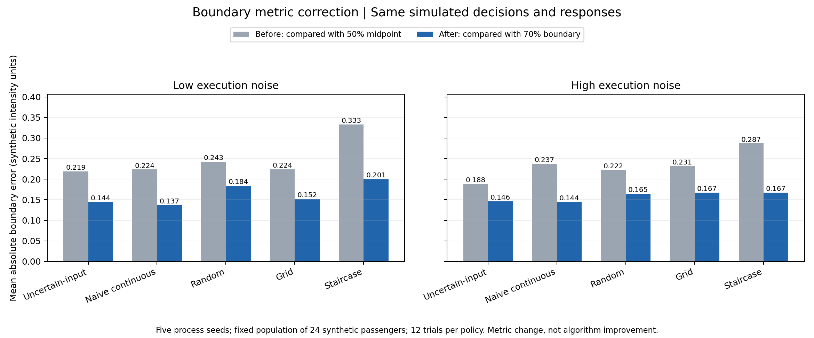

# 仿真边界定义与误差指标修正

日期：2026-11-04。所有结果均来自合成乘客，不包含真人实验。

## 本次完成范围

修正当前 continuous-command extended/POC 仿真的边界真值、误差、越界量及图表，并更新多种子审计。保留原选点策略、随机种子、合成乘客、执行模型和反馈生成过程，以隔离指标修正的影响。早期 `new_idea` 和 VR 复现不属于本次修改范围。

## 原问题与修正

旧 `true_boundary` 实际上是接受概率 50% 的 midpoint。估计器却返回接受概率至少达到 `tau=0.70` 的最大强度，二者相减不是同一目标的估计误差。

现使用与反馈生成器一致的定义：

```text
p(accept | m, history) = clip((1-eta) * sigmoid((midpoint - m - carryover)/s) + eta/2, 0.02, 0.98)
q = (tau - eta/2)/(1-eta)
B_tau(history) = midpoint - carryover - s * log(q/(1-q))
signed error = estimated_boundary - B_tau(history)
absolute error = abs(signed error)
overshoot = max(0, realized_intensity - B_tau(history))
```

没有有限 crossing 的参数会抛出明确错误，不再通过截断 q 人造一个有限边界。真值也不裁剪到指令范围。`tau=0.70` 仍是本研究的操作性标准，不是通用舒适标准。

例如 midpoint=1.2、s=0.2、eta=0.2 时，70% 接受边界为 0.9802775，而非 1.2。若该次试验的 carryover 为 0.02，当前边界为 0.9602775。

字段变化：

| 字段 | 含义 |
|---|---|
| `acceptability_midpoint` | 原 50% midpoint，替代误导性的 `true_boundary` |
| `criterion_boundary_tau_baseline` | 无 carryover 时的 B_tau |
| `criterion_boundary_tau` | 当前试验、当前历史下的 B_tau |
| `boundary_error_so_far` | 当前估计与当前 B_tau 的绝对差 |
| `signed_boundary_error_so_far` | 有符号误差，正值表示高估 |
| `overshoot` | 实测强度超过当前 B_tau 的量 |
| `legacy_midpoint_error_so_far` / `legacy_midpoint_overshoot` | 只为历史比较保留的旧口径，不是有效的 tau 边界指标 |

主 CSV 文件名保留，以上字段属于明确的 schema 变更。读取旧 `true_boundary` 的下游代码需要迁移；历史审计原文件仍保留不覆盖。

## 前后是否改变了模拟过程

对扩展版 2,880 条及 POC 900 条记录，按 scenario、algorithm、participant、trial 对齐并检查原有 41 列（对已更名或更改口径的列映射到显式 legacy 字段）。所有数值最大差异为 **0.0**。

因此，目标指令、实测运动、接受/拒绝、主观评分、累积不适及边界估计本身没有改变。变化来自评价参考点和越界量定义。

重跑范围：

- Extended：2 个执行噪声场景 × 24 名合成乘客 × 5 个策略 × 12 次，共 2,880 条；重新生成 6 个 CSV、9 张 PNG。
- POC：18 名合成乘客 × 5 个策略 × 10 次，共 900 条；重新生成 6 个 CSV、9 张 PNG。
- Audit：5 个过程种子 × 2 个噪声场景，另加 6 个敏感性场景；80 行按策略汇总结果及 10 行多种子汇总。

## 五种子结果

下表是固定 24 人合成人群、每种策略每人 12 次试验下的五过程种子平均。强度为仿真单位。

| 执行噪声 | 策略 | 旧 midpoint 误差 | 修正后 B_tau 误差 |
|---|---|---:|---:|
| 低 | UncertainInputBO | 0.218701 | 0.144391 |
| 低 | NaiveContinuousBO | 0.223658 | 0.136918 |
| 低 | RandomContinuous | 0.242605 | 0.184133 |
| 低 | GridContinuous | 0.224205 | 0.152243 |
| 低 | Staircase | 0.332868 | 0.200628 |
| 高 | UncertainInputBO | 0.188294 | 0.145968 |
| 高 | NaiveContinuousBO | 0.237221 | 0.144355 |
| 高 | RandomContinuous | 0.222302 | 0.164884 |
| 高 | GridContinuous | 0.231468 | 0.167475 |
| 高 | Staircase | 0.286935 | 0.167272 |



最重要的解释变化：旧指标下 UncertainInputBO 的平均误差低于 NaiveContinuousBO；统一到 70% 边界后，NaiveContinuousBO 在两个噪声场景的均值都略低，两者非常接近。当前不能据此声称任一策略具有稳定或统计显著优势，也没有开展配对优效性检验。

五过程种子的 95% t 区间：低噪声 uncertainty-aware 为 [0.109479, 0.179302]、naive 为 [0.091729, 0.182107]；高噪声分别为 [0.120877, 0.171060] 和 [0.127079, 0.161630]。这些是固定人群条件下的过程变异区间，不包含人群不确定性。

不可接受体验次数没有变化：低噪声两种策略分别为 4.15 和 4.241667；高噪声分别为 3.808333 和 4.20。高噪声下 uncertainty-aware 的不可接受暴露较少，仍只是当前生成器中的描述性观察。

误差数值降低不表示算法进步；越界量上升也不表示执行变得更危险。70% 边界低于 50% midpoint，同一条运动轨迹相对于更低边界的超出量自然更大。例如扩展版低噪声 UncertainInputBO 的平均最大越界量由 0.335571 变为 0.475949。

## 与 7 月审计、8 月内部稿的关系

静态场景的修正误差与此前审计的 corrected-tau 列逐项相同，最大差异为 0。8 月论文已使用这些修正值，因此主表结论没有推翻；本次把修正正式落实到了仿真源代码、默认导出与图表。

另外修复了旧审计在 time-effects 场景下遗漏 carryover 的问题。UncertainInputBO 的该场景误差从旧审计修正列的 0.163725 改为 0.124365，NaiveContinuousBO 从 0.136840 改为 0.112782。它们现在相对于末次试验当时的边界评价；这不证明当前静态 surrogate 已能正确建模非平稳反馈。

## 验证与复现

新增测试先在旧代码上失败，修复后通过。覆盖已知概率 crossing、噪声混合反演、carryover、不可达标准、逐次/汇总误差、越界量、审计集成，以及前后对比工具对轨迹变化的拒绝。

```powershell
python -m pytest long_horizon_audit/tests/test_boundary_metrics.py long_horizon_audit/tests/test_boundary_comparison.py long_horizon_audit/tests/test_simulation_audit.py long_horizon_audit/tests/test_dataset_audit.py -q
python comfort_boundary_bo_research_package/simulation/run_uncertain_input_bo_extended.py
python comfort_boundary_bo_research_package/simulation/run_uncertain_input_bo_poc.py
python long_horizon_audit/scripts/run_multiseed_simulation_audit.py --output-dir long_horizon_audit/derived/simulation_audit_corrected_20261104 --seeds 5
python comfort_boundary_bo_research_package/simulation/compare_boundary_results.py --baseline-root results/baseline_before_boundary_fix
```

本地比较时 baseline 路径为 `tmp/boundary_fix_20261104/before`；发布仓库提供对应的原合成 CSV 快照。Python 3.12.7，NumPy 1.26.4，pandas 2.2.2，matplotlib 3.9.2，pytest 7.4.4，openpyxl 3.1.5。

原工作区全量测试中的历史 PPT launcher 测试仍因缺少旧 Presentations runtime 失败，与本次修正无关；不包含该旧演示系统的发布包单独验证。初次基线测试的两项临时目录权限错误，通过把 TEMP/TMP 指向工作区临时目录解决，没有修改数据测试逻辑。

## 仍然存在的研究限制

- Kernel surrogate 仍为启发式，可能非单调，不是正式 Bernoulli posterior。
- 仿真真实执行分布与策略所用分布尚未分离。
- 人群固定，只有过程种子变化。
- grid 顺序、carryover 建模以及 protocol/safety 事件混列仍是后续任务。
- 本次没有验证真实车辆可控性、真人体验或算法优效性。

旧 PPT 和历史报告保留原貌；当前结果以本报告和重新生成的 CSV/PNG 为准。
