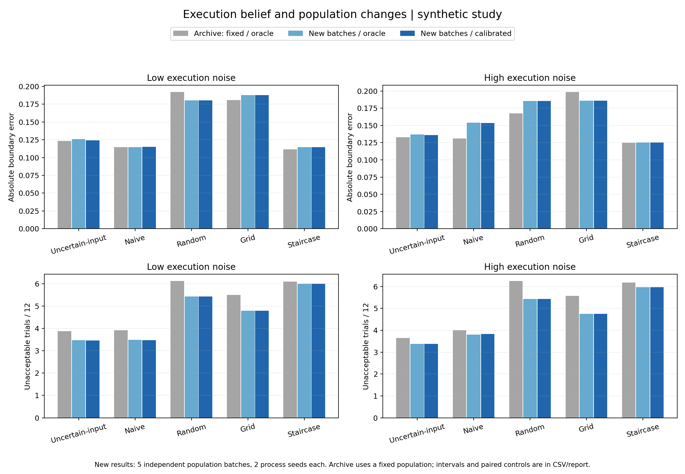
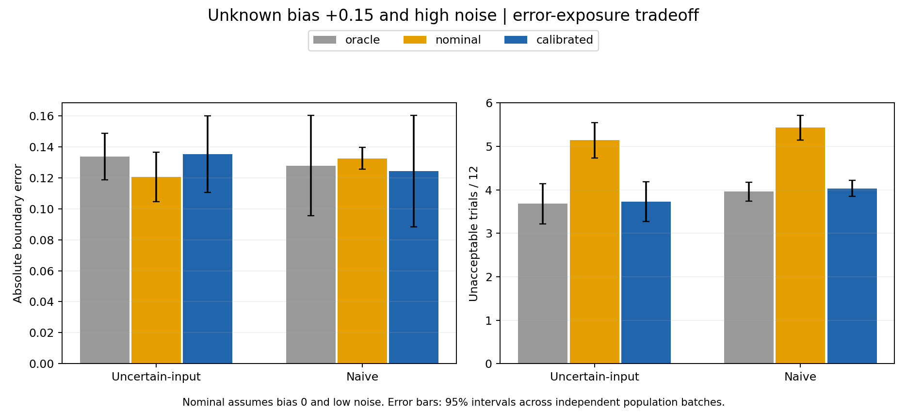

# 执行分布分离与独立人群：结果和解释

日期：2026-11-04。比较基线为 `59af077` 的单调贝叶斯版本。全部数据为合成数据；此次没有使用实车或真人资源。

## 核心结果

真实执行分布与算法估计已分开；默认算法用独立合成校准记录估计偏差和噪声。新实验增加五批独立人群，每批有两个独立过程重复。原来的固定人群、已知真实执行参数设置仍能精确复现。

主实验中，校准估计与已知真实参数的表现接近；换人群的影响更大。未知正偏差/低估噪声时，错误执行假设导致明显更多不可接受试验，即使最终边界误差反而较小。结果说明需要同时看误差和暴露，不能把更小误差直接等同于更好的试验策略。

## 实现改变了什么

`ContinuousExecutionModel` 接收公开的运动/安全设置与独立 `ExecutionParameters`。仿真器持有真实参数，策略持有另一个分布实例。`PolicySettings` 不含真实偏差、噪声、人群/过程种子、反馈噪声；传给策略的历史只包含命令、实测运动和反馈。真值与评价字段仍导出供研究核查，但不进入策略历史。

| 模式 | 算法获得的信息 | 用途 |
|---|---|---|
| `oracle` | 明确复制真实执行参数到独立对象 | 复现旧结果、理想信息对照 |
| `calibrated`（默认） | 独立的命令、加速度、jerk、时长记录 | 拟合执行偏差与噪声尺度 |
| `nominal` | 固定假设偏差 0、噪声尺度 0.65 | 检验错误执行认知 |

校准先用逆方差权重拟合加速度的加性偏差，再用加速度、条件 jerk 和条件时长的标准化残差估计公共噪声尺度，分母为 `3*n-1`。每个执行条件/校准种子使用 **40 次额外合成执行**，命令覆盖公开范围中间 20%–80%；不用乘客反馈，也不从后续测试记录训练。它们由所有策略共享，与每位乘客的 12 次反馈预算分开，不是零成本信息。[NIST 的加权最小二乘说明](https://www.itl.nist.gov/div898/handbook/pmd/section4/pmd432.htm)给出一般方法；具体结构和校准范围是本项目选择。

人群使用 `population_seed`，过程沿用原 `seed`（导出为 `process_seed`），校准使用独立 `SeedSequence([calibration_seed, 0xCA1B])`。这三个种子角色互不隐式派生；每个比较对共享同一组相关种子。独立随机流的实现依据 [NumPy 官方说明](https://numpy.org/doc/stable/reference/random/parallel.html)。另修复批量入口复用首批乘客的问题，现在每个场景按自己的人群种子生成乘客。

单调响应后验、真实反馈生成器、B_tau 定义、选点分数及系数都保持不变。执行分布仍使用已知函数结构，只估计偏差与公共噪声尺度；这不是从零识别车辆动力学，也不包含在线更新或执行参数后验传播。

## 实验与统计单位

所有审计场景使用 24 人 × 5 策略 × 12 次反馈，共 85 场景、425 条策略汇总、10,200 条个体/策略汇总，实际生成 122,400 条反馈试验。

| 组别 | 设置 | 场景数 |
|---|---|---:|
| 历史复现 | 原固定人群 × 原五过程种子 × 两噪声；oracle | 10 |
| 独立人群 | 五人群种子 × 每批两过程种子 × 两噪声 × oracle/calibrated | 40 |
| 固定人群对照 | 与独立人群组完全相同的过程/噪声条件，但保持原人群；oracle | 20 |
| 压力测试 | 五批人群 × 一过程种子 × 高噪声、真实偏差 +0.15 × 三种执行认知 | 15 |

人群种子为 `2026110401`–`2026110405`；原固定人群种子为 `20260804`。过程/校准种子嵌套在人群批次中，批次之间不共用过程流；同批次的成对版本共用。完整数值在配置 JSON 中。

主实验先在每批人群内平均两个过程重复，再在五个批次均值或配对差值上计算 95% t 区间（df=4）。压力测试每批一个过程种子。这样不会把 24 人 × 重复次数错误地当作独立人群重复。区间包含本设计的批次、过程和校准抽样变化，但仅有五批且未作多重比较校正。固定人群对照的区间明确标为过程区组区间。

## 和上一版相比

以下都是平均绝对 B_tau 误差；旧版与最后一列同时改变了过程样本、人群和执行认知，不能将总差异全部归功于新模型。

| 执行噪声 / 策略 | 上一版固定人群、oracle | 同新过程种子的固定人群、oracle | 新人群、oracle | 新人群、calibrated |
|---|---:|---:|---:|---:|
| 低 / UncertainInputBO | 0.12332 | 0.11887 | 0.12573 | **0.12415** |
| 高 / UncertainInputBO | 0.13270 | 0.12565 | 0.13696 | **0.13613** |
| 低 / NaiveContinuousBO | 0.11475 | 0.11233 | 0.11472 | **0.11489** |
| 高 / NaiveContinuousBO | 0.13102 | 0.14573 | 0.15405 | **0.15333** |

对 UncertainInputBO，把同批新人群的 oracle 换成 calibrated，低/高噪声误差变化为 **-0.00158 / -0.00083**，配对区间分别为 **[-0.00826, 0.00509] / [-0.00742, 0.00576]**。不可接受次数变化为 -0.0125 / 0.0000，区间也跨零：在这套结构正确、40 次校准的仿真中，估计分布与 oracle 很接近，不能称有性能提升。

固定过程流，仅把原人群换成独立新人群，UncertainInputBO 低/高噪声误差变化为 **+0.00687 / +0.01131**；配对区间分别为 [-0.01166, 0.02539] / [0.00178, 0.02084]。不可接受次数却减少 0.2458 / 0.2250。原固定人群的平均 50% 接受 midpoint 为 **1.1021**，新人群合并为 **1.2236**（各批 1.1384–1.2817）。因此这次抽到的人群平均可接受强度更高，是暴露下降的一个可核查背景；敏感度等也变化，不能把差异全归因于 midpoint。

完整分步表见 [before_after_stages.csv](../results/execution_population_20261104/before_after_stages.csv)，配对区间见 [paired_population_effects.csv](../results/execution_population_20261104/paired_population_effects.csv)，人群参数汇总见 [population_traits.csv](../results/execution_population_20261104/population_traits.csv)。

## 新默认执行认知下，各策略表现

| 噪声 | 策略 | 平均边界误差 | 不可接受次数 / 12 | 95% 边界区间平均宽度 | 真值覆盖率 |
|---|---|---:|---:|---:|---:|
| 低 | UncertainInputBO | 0.12415 | 3.467 | 0.989 | 97.9% |
| 高 | UncertainInputBO | 0.13613 | 3.379 | 0.961 | 97.9% |
| 低 | NaiveContinuousBO | 0.11489 | 3.475 | 0.995 | 99.6% |
| 高 | NaiveContinuousBO | 0.15333 | 3.833 | 0.998 | 95.0% |
| 低 | RandomContinuous | 0.18041 | 5.438 | 1.110 | 95.4% |
| 高 | RandomContinuous | 0.18557 | 5.425 | 1.117 | 95.8% |
| 低 | GridContinuous | 0.18776 | 4.800 | 1.061 | 94.2% |
| 高 | GridContinuous | 0.18590 | 4.742 | 1.120 | 95.8% |
| 低 | Staircase | 0.11457 | 6.008 | 1.164 | 95.8% |
| 高 | Staircase | 0.12497 | 5.963 | 1.118 | 97.9% |

UncertainInputBO 的低/高噪声平均误差区间为 [0.10124, 0.14705] / [0.10941, 0.16284]。低噪声下 Naive 的均值较小，高噪声下顺序相反；这里只描述均值，不宣称算法普遍占优。Staircase 误差较小但暴露较多。12 次反馈后的区间仍宽，高覆盖不能单独证明估计已经精确。

默认扩展版/POC 图表是单次运行示例，仍用历史人群以便直接复现；多批人群的结论以本审计为准。单次扩展版 UncertainInputBO 误差低噪声 0.11352 → 0.12923，高噪声 0.12886 → 0.12012，方向不同也说明不应只看单种子图。

## 未知执行偏差和低估噪声

真实偏差为 +0.15、噪声尺度 1.55；nominal 错误地假设偏差 0、噪声尺度 0.65。以下为五批独立人群的均值：

| 策略 / 执行认知 | 边界误差 | 不可接受次数 / 12 |
|---|---:|---:|
| UncertainInputBO / oracle | 0.13378 | 3.683 |
| UncertainInputBO / nominal | 0.12056 | 5.142 |
| UncertainInputBO / calibrated | 0.13545 | 3.725 |
| NaiveContinuousBO / oracle | 0.12791 | 3.958 |
| NaiveContinuousBO / nominal | 0.13257 | 5.433 |
| NaiveContinuousBO / calibrated | 0.12442 | 4.033 |

UncertainInputBO 从 nominal 改为 calibrated 后，不可接受次数平均减少 **1.4167 次（27.6%）**，配对区间 **[-1.5380, -1.2954]**；边界误差增加 0.01488，区间 [-0.01065, 0.04041]。校准版本与 oracle 的不可接受次数差仅 +0.0417，区间跨零。错误假设下较低的边界误差伴随更多不可接受反馈，不能当作整体优势。该压力测试同时改变未知偏差与噪声误设，不能拆解两者各自的贡献。

全审计的 25 个校准条件中，偏差估计平均绝对误差为 **0.01631**，噪声尺度估计平均绝对误差 **0.03977**，没有校准记录触及实际裁剪边界。压力组平均估计偏差/噪声尺度为 0.14069/1.55163，对应真值 0.15/1.55。这是在已知正确函数结构下的结果，不验证任意执行分布失配。

## 验证与剩余限制

48 项测试通过。85 场景、425 条策略汇总都与配置清单匹配；历史 50 条汇总的全部原有数值最大差为 0。75 个固定策略配对单元的轨迹指纹一致。代码、配置、人群参数、校准记录和结果均保存，详见[验证报告](2026-11-04-execution-population-verification.md)。

后续优先检验执行模型的增益/非线性/相关噪声失配和不同校准预算，再考虑执行参数后验传播、在线更新或信息增益选点。当前选择仍是启发式；五批人群不是对真实乘客总体的验证。高反馈噪声、lapse、时间效应及先验敏感性仍沿用上一轮已披露限制。
