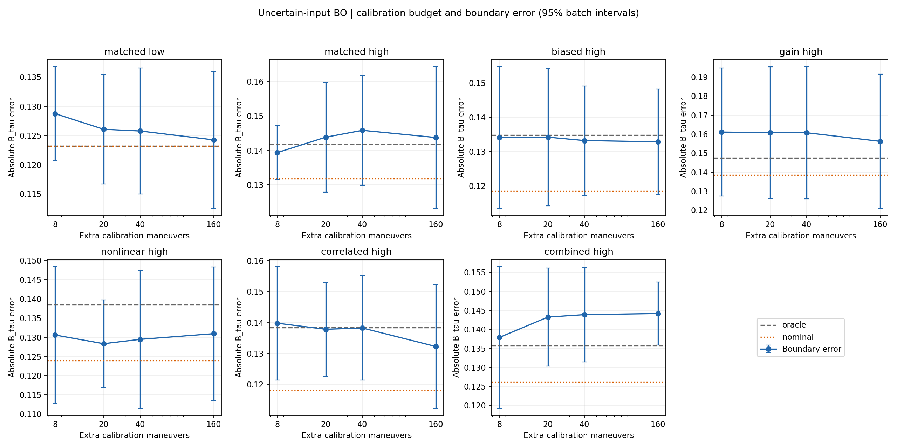
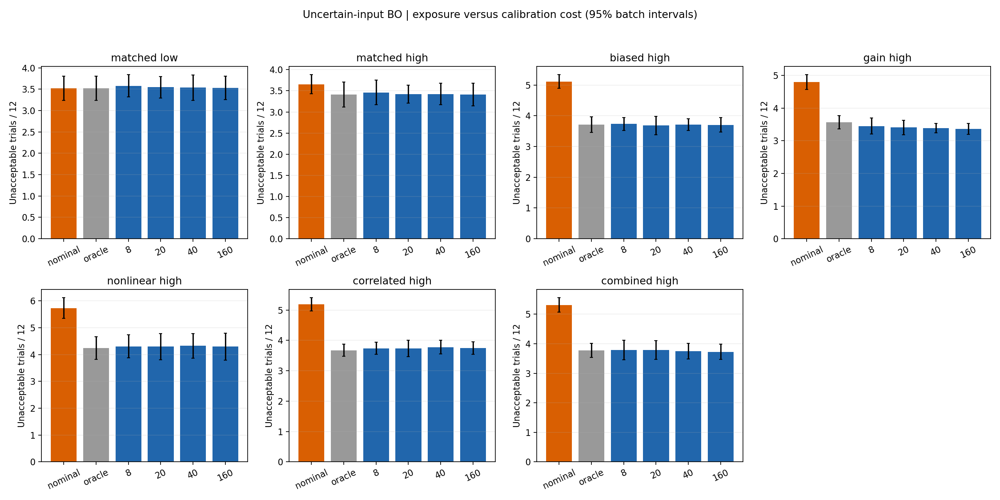
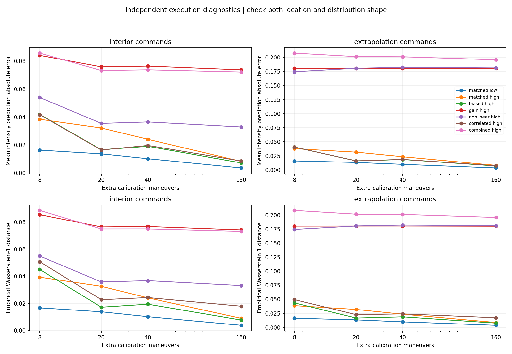

# 执行模型失配与校准预算：结果与适用范围

日期：2026-11-04。基线为 `e06f0e2`。本轮只使用合成执行和合成人群，执行校准器、响应模型和选点规则均未升级。

## 本轮检验什么

上一轮“校准版接近已知真参数对照”建立在执行函数结构正确、40 次校准的条件上。本轮故意让真实执行偏离算法假定的结构，检验这个结论和降低不可接受试验的结论能否延续，同时比较校准成本。

| 条件 | 真实噪声尺度 | 真实偏差 | 额外结构变化 |
|---|---:|---:|---|
| 结构正确／低噪声 | 0.65 | 0 | 无 |
| 结构正确／高噪声 | 1.55 | 0 | 无 |
| 仅偏差／高噪声 | 1.55 | +0.15 | 无 |
| 增益失配 | 1.55 | +0.15 | 加速度均值增加 0.25d |
| 非线性失配 | 1.55 | +0.15 | 加速度均值增加 0.45d² |
| 相关噪声失配 | 1.55 | +0.15 | 加速度与条件 jerk／时长残差相关系数 0.75 |
| 组合失配 | 1.55 | +0.15 | 上述三种结构变化同时存在 |

其中 d=x−1.125；加速度、jerk、时长仍使用原裁剪边界。jerk 与时长的标准化残差相关系数为 0.75²。扰动强度是运行前固定的合成压力条件，未从实车数据标定，也不代表完整的车辆失配范围。

每个条件比较固定假设 nominal（偏差 0、噪声 0.65）、完整真分布 oracle，以及 8／20／40／160 次校准。oracle 明确知道增益、非线性和相关结构，使用独立对象；校准版始终只拟合原来的偏差与公共噪声尺度，没有获得结构真值。oracle 是信息对照，启发式选点下不保证每个结果指标最优。

沿用上一轮相同的五批合成人群以便配对，没有扩大人群覆盖度。五批人群 × 每批两个过程重复 × 七个条件 × 六个认知／预算，共 420 个新场景；每场景 24 人 × 五种策略 × 12 次反馈。另重放上一轮 55 个场景，共生成 684,000 条反馈试验。校准成本是每个执行条件共享的额外执行次数，不从每人的 12 次反馈预算中扣除。

预算实验使用相同校准观测序列的前 8／20／40／160 条；新增预算只追加数据。命令按二进制 radical-inverse 顺序覆盖公开范围中间 20%–80%。这与上一轮排序的等间距校准不同，差异在后文单独列出。

先在每个人群批次内平均两个过程重复，再用五个批次计算 t 区间；配对版本共享人群、过程和校准根种子。跨失配条件共用随机数是有意的对照设计，不是新增独立样本。所有区间为描述性的 95% 区间、未作多重比较校正；区间跨零不能证明等效。

## 40 次校准时与两个对照的差异

下表均为 UncertainInputBO。边界误差为平均绝对 B_tau 误差；不可接受次数以每 12 次反馈计算。正变化表示校准版数值更高。

| 条件 | oracle 边界误差 | 校准边界误差 | 校准−oracle 误差及区间 | nominal 不可接受次数 | 校准不可接受次数 | 校准−nominal 次数及区间 |
|---|---:|---:|---|---:|---:|---|
| 结构正确／低噪声 | 0.1232 | 0.1258 | +0.0025 [+0.0004, +0.0046] | 3.521 | 3.538 | +0.017 [-0.0217, +0.0550] |
| 结构正确／高噪声 | 0.1417 | 0.1458 | +0.0041 [+0.0018, +0.0063] | 3.654 | 3.425 | -0.229 [-0.3089, -0.1494] |
| 仅偏差／高噪声 | 0.1348 | 0.1333 | -0.0016 [-0.0085, +0.0054] | 5.117 | 3.712 | -1.404 [-1.5894, -1.2189] |
| 增益失配 | 0.1474 | 0.1607 | +0.0133 [+0.0052, +0.0214] | 4.796 | 3.383 | -1.413 [-1.6642, -1.1608] |
| 非线性失配 | 0.1386 | 0.1295 | -0.0091 [-0.0124, -0.0058] | 5.729 | 4.321 | -1.408 [-1.6379, -1.1787] |
| 相关噪声失配 | 0.1383 | 0.1382 | -0.0001 [-0.0071, +0.0069] | 5.187 | 3.779 | -1.408 [-1.5972, -1.2195] |
| 组合失配 | 0.1357 | 0.1439 | +0.0082 [-0.0054, +0.0217] | 5.317 | 3.750 | -1.567 [-1.8724, -1.2610] |

## 校准预算变化

每格为“边界误差／不可接受次数”，策略为 UncertainInputBO。预算增加不意味着这两个最终指标都单调改善。

| 条件 | 8 次 | 20 次 | 40 次 | 160 次 |
|---|---:|---:|---:|---:|
| 结构正确／低噪声 | 0.1287 / 3.579 | 0.1261 / 3.546 | 0.1258 / 3.538 | 0.1243 / 3.529 |
| 结构正确／高噪声 | 0.1394 / 3.458 | 0.1438 / 3.421 | 0.1458 / 3.425 | 0.1437 / 3.413 |
| 仅偏差／高噪声 | 0.1341 / 3.733 | 0.1342 / 3.683 | 0.1333 / 3.712 | 0.1329 / 3.704 |
| 增益失配 | 0.1610 / 3.446 | 0.1608 / 3.408 | 0.1607 / 3.383 | 0.1562 / 3.358 |
| 非线性失配 | 0.1306 / 4.304 | 0.1283 / 4.292 | 0.1295 / 4.321 | 0.1309 / 4.292 |
| 相关噪声失配 | 0.1398 / 3.742 | 0.1378 / 3.733 | 0.1382 / 3.779 | 0.1323 / 3.750 |
| 组合失配 | 0.1379 / 3.792 | 0.1432 / 3.788 | 0.1439 / 3.750 | 0.1442 / 3.729 |

## 独立执行预测检查

在全命令范围的 21 个固定点，每点另抽 4,096 个真分布与估计分布样本，不参与校准或选点。诊断流使用独立命名空间；真／估计分布在每个比较中共用随机数以降低 Monte Carlo 差异。表中的均值误差和 Wasserstein-1 距离先对相应范围内命令平均，再按批次汇总。

| 条件 | 范围内均值误差：8→160 | 范围外均值误差：8→160 | 160 次范围外分布距离 | 160 次范围外预测 90% 区间覆盖率 |
|---|---:|---:|---:|---:|
| 结构正确／低噪声 | 0.0162→0.0034 | 0.0159→0.0033 | 0.0037 | 89.7% |
| 结构正确／高噪声 | 0.0383→0.0082 | 0.0377→0.0080 | 0.0087 | 89.7% |
| 仅偏差／高噪声 | 0.0418→0.0071 | 0.0404→0.0069 | 0.0076 | 90.3% |
| 增益失配 | 0.0841→0.0737 | 0.1803→0.1801 | 0.1801 | 58.1% |
| 非线性失配 | 0.0539→0.0328 | 0.1743→0.1810 | 0.1810 | 53.4% |
| 相关噪声失配 | 0.0416→0.0084 | 0.0404→0.0073 | 0.0171 | 86.8% |
| 组合失配 | 0.0857→0.0722 | 0.2073→0.1954 | 0.1957 | 64.2% |

这些是执行分布诊断，不能与乘客 B_tau 的 95% 后验区间覆盖率混用。分布距离与覆盖率是有限样本近似；物理裁剪会形成点质量，包含端点的预测区间实际覆盖率可以高于名义 90%。诊断图同时显示位置误差和分布形状差异，避免均值接近掩盖相关噪声失配。残差和分布检查的方法动机参见 [NIST 模型验证说明](https://www.itl.nist.gov/div898/handbook/pmd/section4/pmd44.htm)。

## 与上一轮结果的衔接

历史重放使用上一轮原校准顺序、参数和随机种子。275 条策略汇总的全部原字段与已发布快照一致，最大数值差为 0。以下仅比较同一人群、同一过程下，把 40 次排序网格改为 40 次嵌套顺序的变化；仅偏差组使用上一轮已有的第一个过程重复。

| 条件 | 原边界误差→新边界误差 | 误差变化区间 | 原不可接受次数→新次数 | 次数变化区间 |
|---|---:|---|---:|---|
| 结构正确／低噪声 | 0.1258→0.1258 | [-0.0027, +0.0027] | 3.542→3.538 | [-0.0325, +0.0242] |
| 结构正确／高噪声 | 0.1455→0.1458 | [-0.0018, +0.0024] | 3.413→3.425 | [-0.0222, +0.0472] |
| 仅偏差／高噪声 | 0.1282→0.1264 | [-0.0077, +0.0041] | 3.833→3.842 | [-0.0591, +0.0758] |

## 哪些旧结论仍成立

**“校准能减少错误执行假设带来的不可接受试验”在本次偏差/失配条件下仍成立。** 40 次校准在仅偏差和四类结构失配中，相对 nominal 每 12 次减少约 1.40–1.57 次不可接受反馈（24.6%–29.5%），五个配对区间均低于零。这是相对本次明确偏乐观的 nominal 的结论，不是相对所有候选方法的保证。低噪声、结构正确时 nominal 本就等于 oracle，校准没有带来暴露优势。

**“40 次校准接近 oracle”必须保留结构条件。** 结构正确时低/高噪声边界误差增加约 0.0025/0.0041，仍是小幅均值代价；仅偏差和相关噪声条件没有明显的均值偏离，但未做等效性检验。增益失配时误差增加 0.0133，配对区间 [0.0052, 0.0214]，不能把前述结论直接推广过去。组合失配的均值增加 0.0082，但区间跨零，精确影响仍不确定。

**“增加预算一定改善最终边界估计”不成立。** 在结构正确时，8→160 次能明显改善独立执行预测，但高噪声的边界误差均值反而从 0.1394 变为 0.1437。160 相对 40 次的边界误差变化区间在七种条件下全部跨零；本设计没有提供四倍校准成本带来稳定最终收益的证据。这不等于证明两种预算等效，也不能据此把 40 次定为最优或充分预算。

**“更多数据能补救错误函数结构”不成立。** 160 次时，增益、非线性和组合失配的范围外均值误差仍约 0.180–0.195，名义 90% 执行预测区间的覆盖率只有 53%–64%。相关噪声失配的均值误差较小，但分布距离仍约 0.017、覆盖率约 87%。因此下一步应优先检验更合适的执行模型结构和分布诊断，而不是单纯扩大当前校准预算。

**“UncertainInputBO 普遍优于 Naive”仍没有依据，误差与暴露的权衡仍存在。** 40 次校准下，高噪声六种条件中 UncertainInputBO 相对 Naive 的不可接受次数均值更少（约 0.34–0.42 次，配对区间均低于零），但边界误差排序会变化。组合失配下 UncertainInputBO 的误差反而增加 0.0122，区间 [0.0028, 0.0215]，同时不可接受次数减少 0.383，区间 [-0.695, -0.072]。所有这些区间都是未校正多重比较的探索性结果。

非线性条件中校准版的边界误差低于 oracle，也不能证明它学对了执行模型：响应后验使用实测强度和二元反馈，执行 belief 主要影响选点，错误 belief 偶然产生更有利的采样位置并不矛盾。40 次校准后的 B_tau 区间平均宽度仍约 0.96–1.06、覆盖率约 95.4%–97.5%；高覆盖伴随宽区间，不应当作高精度或执行预测可信的证据。

## 验证、文件与剩余限制

完整验证记录见[验证报告](2026-11-04-execution-robustness-verification.md)。新场景 420 个、策略汇总 2100 条、独立执行诊断 8820 行；9,360 个实际过程子流状态无意外重复，210 个固定策略配对单元的轨迹一致。280 组校准观测通过预算前缀检查。单个条件最多排除 0 条触及裁剪边界的校准记录，详见参数表。

- [全部策略与指标](../results/execution_robustness_20261104/population_summary.csv)
- [配对变化及区间](../results/execution_robustness_20261104/paired_effects.csv)
- [独立执行诊断](../results/execution_robustness_20261104/execution_diagnostics_summary.csv)
- [校准参数和裁剪计数](../results/execution_robustness_20261104/calibration_parameters.csv)
- [校准顺序变化](../results/execution_robustness_20261104/calibration_schedule_effects.csv)

执行参数仍为离线点估计，没有传播估计不确定性。增加校准数据不扩大所拟合模型的函数族；本轮没有处理在线漂移、执行历史依赖、任意非高斯/重尾噪声、未知强度映射、反馈模型变化或校准分布迁移。五批合成人群不是实车或真人验证；不可接受反馈和协议阈值也不是事故风险概率。
