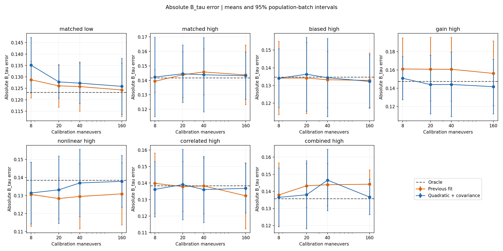
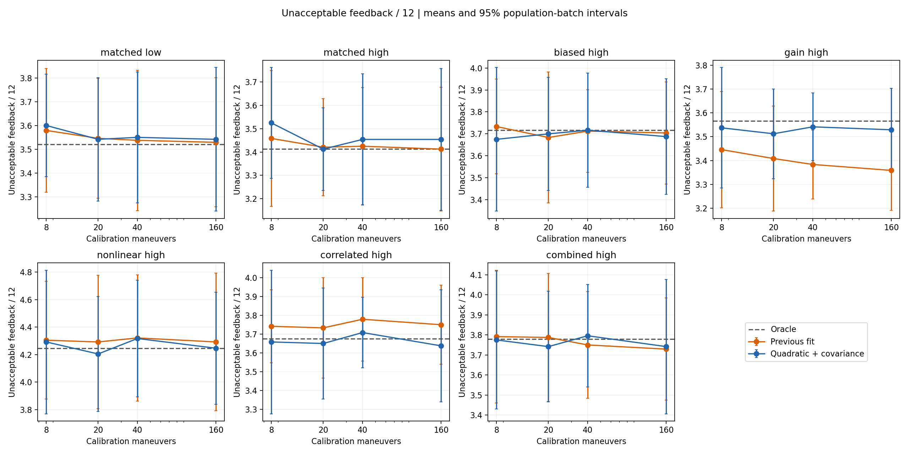
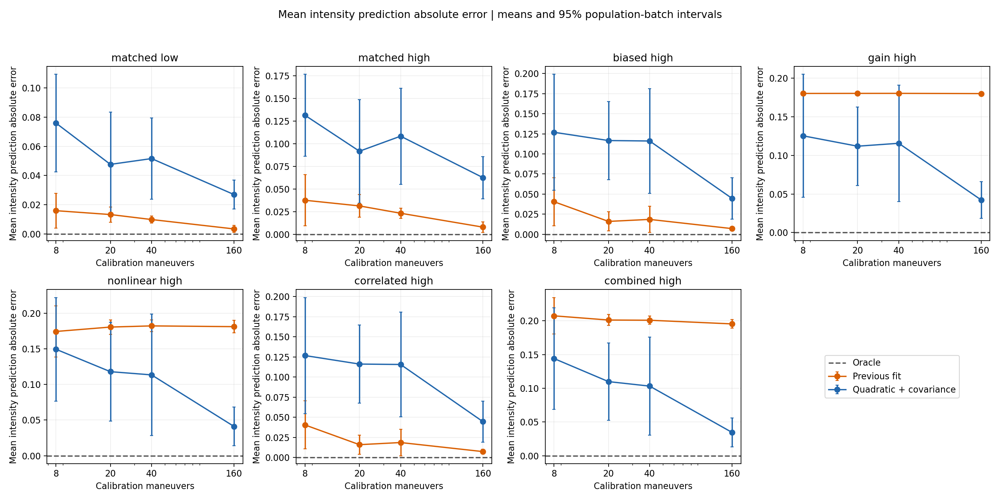
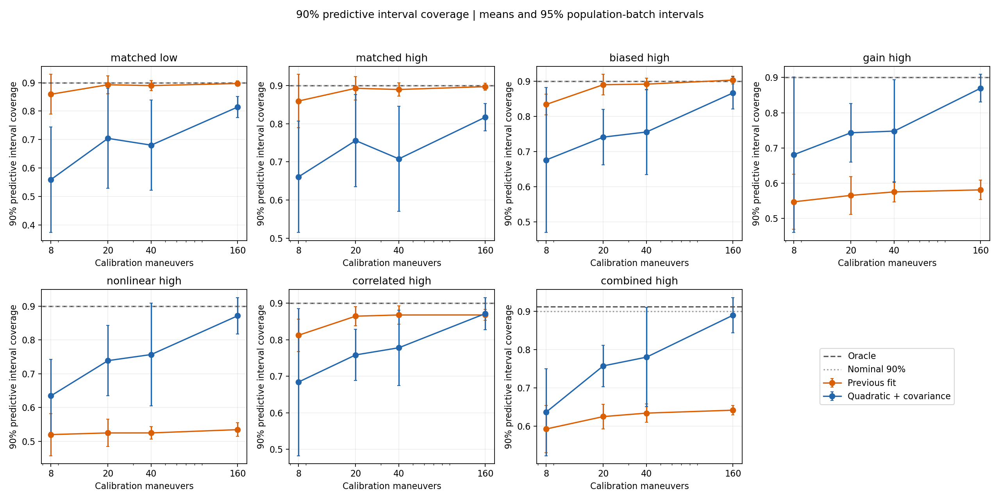

# 执行估计扩展：新旧模型、预算与剩余问题

本轮在增益、二次非线性和组合扰动下明显改善了执行分布的范围外预测；但额外均值参数也让结构正确及仅相关噪声条件的预测退步。40 次校准时，增益组的最终边界误差下降约 10.3%，同时不可接受反馈增加。模型容量扩大了，最终精度、暴露和校准成本仍需分别判断。

日期：2026-11-04；基线 `9679123`。本轮新增可拟合增益、二次非线性和完整通道残差协方差的执行 belief。真实执行、乘客人群、响应后验和选点规则保持原样。全部数据均为合成执行和合成人群。

[模型、固定正则化和复现方法](2026-11-04-flexible-execution-method.md)；[验证记录](2026-11-04-flexible-execution-verification.md)。

## 比较设计

七种真实条件、8/20/40/160 次额外校准、五批人群、每批两个过程重复。280 个新模型场景，与上一版同校准观测、同种子逐一比较；另完整重放上一版 420 个场景。每场景 24 人×五策略×12 次反馈，总计 1,008,000 次。oracle 知道完整真分布，是信息对照，不保证启发式算法下每个指标最优；nominal 使用固定偏差 0/噪声 0.65。

主表中的边界误差是平均绝对 B_tau 误差，暴露是每人 12 次反馈中的不可接受次数。所有配对区间先平均批次内两个过程重复，再跨五批计算 95% t 区间，未校正多重比较。区间跨零不能证明等效；沿用原五批人群，没有新增独立人群覆盖。

## 40 次校准：最终边界与暴露

均为 UncertainInputBO。变化为新模型−旧模型；边界误差和不可接受次数均越低越好。

| 条件 | 边界误差：旧→新 | 误差变化及 95% 区间 | 不可接受次数：旧→新 | 次数变化及 95% 区间 |
|---|---|---|---|---|
| 结构正确／低噪声 | 0.1258 → 0.1273 | +0.0015 [-0.0045, +0.0074] | 3.538 → 3.550 | +0.013 [-0.031, +0.056] |
| 结构正确／高噪声 | 0.1458 → 0.1438 | -0.0020 [-0.0139, +0.0099] | 3.425 → 3.454 | +0.029 [-0.102, +0.161] |
| 仅偏差／高噪声 | 0.1333 → 0.1344 | +0.0011 [-0.0160, +0.0183] | 3.712 → 3.717 | +0.004 [-0.074, +0.083] |
| 增益 | 0.1607 → 0.1441 | -0.0166 [-0.0213, -0.0118] | 3.383 → 3.542 | +0.158 [+0.129, +0.188] |
| 二次非线性 | 0.1295 → 0.1370 | +0.0075 [-0.0049, +0.0199] | 4.321 → 4.317 | -0.004 [-0.080, +0.072] |
| 通道相关噪声 | 0.1382 → 0.1361 | -0.0022 [-0.0117, +0.0073] | 3.779 → 3.708 | -0.071 [-0.133, -0.009] |
| 组合扰动 | 0.1439 → 0.1466 | +0.0027 [-0.0081, +0.0135] | 3.750 → 3.796 | +0.046 [+0.012, +0.080] |

## 新模型的校准预算

每格为“边界误差／不可接受次数”，均为 UncertainInputBO。校准成本与每人 12 次反馈分开核算。

| 条件 | 8 次 | 20 次 | 40 次 | 160 次 |
|---|---|---|---|---|
| 结构正确／低噪声 | 0.1351 / 3.600 | 0.1278 / 3.542 | 0.1273 / 3.550 | 0.1259 / 3.542 |
| 结构正确／高噪声 | 0.1423 / 3.525 | 0.1445 / 3.413 | 0.1438 / 3.454 | 0.1432 / 3.454 |
| 仅偏差／高噪声 | 0.1341 / 3.675 | 0.1364 / 3.700 | 0.1344 / 3.717 | 0.1323 / 3.688 |
| 增益 | 0.1509 / 3.538 | 0.1440 / 3.513 | 0.1441 / 3.542 | 0.1417 / 3.529 |
| 二次非线性 | 0.1314 / 4.292 | 0.1332 / 4.204 | 0.1370 / 4.317 | 0.1379 / 4.246 |
| 通道相关噪声 | 0.1361 / 3.658 | 0.1391 / 3.650 | 0.1361 / 3.708 | 0.1368 / 3.638 |
| 组合扰动 | 0.1365 / 3.775 | 0.1380 / 3.742 | 0.1466 / 3.796 | 0.1367 / 3.742 |

## 独立执行分布检查

全范围 21 个命令点，每点 4096 个样本，不进入校准或选点。下表为校准范围之外的命令，160 次校准；均值误差和 Wasserstein-1 距离越低越好。预测区间目标为 90%，但物理裁剪可能形成点质量，不能机械要求所有点恰好覆盖 90%。

| 条件 | 均值预测误差：旧→新 | Wasserstein-1：旧→新 | 90% 区间覆盖率：旧→新 |
|---|---|---|---|
| 结构正确／低噪声 | 0.0033 → 0.0269 | 0.0037 → 0.0269 | 89.7% → 81.4% |
| 结构正确／高噪声 | 0.0080 → 0.0626 | 0.0087 → 0.0626 | 89.7% → 81.7% |
| 仅偏差／高噪声 | 0.0069 → 0.0446 | 0.0076 → 0.0454 | 90.3% → 86.7% |
| 增益 | 0.1801 → 0.0424 | 0.1801 → 0.0433 | 58.1% → 87.0% |
| 二次非线性 | 0.1810 → 0.0411 | 0.1810 → 0.0418 | 53.4% → 87.2% |
| 通道相关噪声 | 0.0073 → 0.0445 | 0.0171 → 0.0455 | 86.8% → 87.1% |
| 组合扰动 | 0.1954 → 0.0345 | 0.1957 → 0.0353 | 64.2% → 89.0% |

新模型的范围外执行预测覆盖率随预算变化如下。这是未来执行强度的预测区间，与乘客 B_tau 的 95% 后验可信区间不同。

| 条件 | 8 次 | 20 次 | 40 次 | 160 次 |
|---|---|---|---|---|
| 结构正确／低噪声 | 55.9% | 70.4% | 68.0% | 81.4% |
| 结构正确／高噪声 | 66.1% | 75.6% | 70.8% | 81.7% |
| 仅偏差／高噪声 | 67.6% | 74.1% | 75.6% | 86.7% |
| 增益 | 68.1% | 74.3% | 74.8% | 87.0% |
| 二次非线性 | 63.5% | 73.9% | 75.7% | 87.2% |
| 通道相关噪声 | 68.4% | 75.8% | 77.8% | 87.1% |
| 组合扰动 | 63.7% | 75.7% | 78.0% | 89.0% |

## 160 次相对 40 次的成对变化

正值表示该指标更高。执行预测误差取范围外均值误差；最终反馈指标为 UncertainInputBO。

| 条件 | 执行预测误差变化及区间 | 边界误差变化及区间 | 不可接受次数变化及区间 |
|---|---|---|---|
| 结构正确／低噪声 | -0.0247 [-0.0463, -0.0030] | -0.0014 [-0.0087, +0.0059] | -0.008 [-0.052, +0.035] |
| 结构正确／高噪声 | -0.0458 [-0.0850, -0.0066] | -0.0007 [-0.0127, +0.0114] | -0.000 [-0.138, +0.138] |
| 仅偏差／高噪声 | -0.0715 [-0.1406, -0.0023] | -0.0021 [-0.0139, +0.0097] | -0.029 [-0.134, +0.075] |
| 增益 | -0.0733 [-0.1506, +0.0040] | -0.0024 [-0.0104, +0.0056] | -0.013 [-0.059, +0.034] |
| 二次非线性 | -0.0723 [-0.1672, +0.0226] | +0.0009 [-0.0077, +0.0094] | -0.071 [-0.100, -0.041] |
| 通道相关噪声 | -0.0711 [-0.1403, -0.0020] | +0.0007 [-0.0093, +0.0107] | -0.071 [-0.211, +0.069] |
| 组合扰动 | -0.0686 [-0.1504, +0.0132] | -0.0099 [-0.0208, +0.0010] | -0.054 [-0.168, +0.059] |

## 40 次校准：新模型与参考策略

以下区间用于检查先前结论是否延续，不能只看均值排序。Uncertain−Naive 的误差为正表示 Uncertain 边界误差更高；次数为负表示不可接受反馈更少。

| 条件 | 新−oracle 边界误差 | 新−nominal 不可接受次数 | Uncertain−Naive 边界误差 | Uncertain−Naive 不可接受次数 |
|---|---|---|---|---|
| 结构正确／低噪声 | +0.0040 [-0.0037, +0.0117] | +0.029 [-0.018, +0.076] | -0.0151 [-0.0279, -0.0023] | -0.062 [-0.241, +0.116] |
| 结构正确／高噪声 | +0.0021 [-0.0087, +0.0129] | -0.200 [-0.287, -0.113] | +0.0149 [-0.0255, +0.0552] | -0.371 [-0.746, +0.004] |
| 仅偏差／高噪声 | -0.0004 [-0.0115, +0.0107] | -1.400 [-1.640, -1.160] | +0.0022 [-0.0198, +0.0243] | -0.429 [-0.654, -0.205] |
| 增益 | -0.0033 [-0.0141, +0.0076] | -1.254 [-1.496, -1.013] | +0.0004 [-0.0415, +0.0423] | -0.429 [-0.639, -0.219] |
| 二次非线性 | -0.0016 [-0.0110, +0.0079] | -1.412 [-1.670, -1.155] | +0.0047 [-0.0157, +0.0251] | -0.263 [-0.554, +0.029] |
| 通道相关噪声 | -0.0023 [-0.0127, +0.0081] | -1.479 [-1.645, -1.314] | -0.0003 [-0.0207, +0.0201] | -0.429 [-0.666, -0.192] |
| 组合扰动 | +0.0108 [-0.0045, +0.0262] | -1.521 [-1.806, -1.236] | +0.0132 [-0.0074, +0.0338] | -0.417 [-0.665, -0.168] |

## 结果解释与仍未解决的问题

**增益、二次非线性和组合扰动的结构误差得到实质缓解。** 160 次校准时，三组范围外强度均值预测误差分别减少约 76.5%、77.3%、82.3%，对应新−旧配对区间为 [-0.1610, -0.1144]、[-0.1641, -0.1158]、[-0.1789, -0.1429]。Wasserstein-1 距离同步降低，90% 执行预测覆盖率由约 53%–64% 恢复到约 87%–89%。旧版“仅增加校准数据补不了错误均值结构”的诊断仍成立；本次新增的是合适结构配合较多数据可以改善这些已指定的失配。

**相关结构可以估计，但同时放开均值结构会付出方差代价。** 仅相关噪声组在 160 次校准下，三种相关系数的估计均值为 0.752、0.755、0.597，真实值为 0.750、0.750、0.5625；不再强制独立。可是该组本来不需要增益和曲率，拟合曲率在十个校准重复中的标准差仍为 0.142。范围外均值误差从 0.0073 增到 0.0445，Wasserstein-1 从 0.0171 增到 0.0455；覆盖率均值虽约为 87%，不能据此称整体分布已更准确。结构正确低/高噪声及仅偏差组三组的范围外均值误差也上升，160 次新−旧差异区间均高于零。新增参数的估计波动被外推放大，与这些现象一致；本轮没有额外消融来单独量化各参数的因果贡献。

**小预算执行预测仍不可靠。** 新模型 8 次校准的范围外 90% 区间覆盖率只有约 56%–68%；40 次也只有约 68%–78%。160 次有所恢复，但结构正确的低/高噪声组仍只有约 81%–82%。现实现只使用参数点估计，未把均值/协方差估计不确定性传播到预测分布。固定正则化和单调约束保证了协方差正定和加速度均值单调，但并未保证小样本外推校准。没有根据这些结果事后更改正则化常数。

**执行预测改善不会自动变成最终边界收益。** 40 次校准时，增益组边界误差 0.1607→0.1441，下降约 10.3%，差异区间全低于零；同时不可接受反馈 3.383→3.542，每 12 次增加 0.158，区间 [0.129, 0.188]。组合组的不可接受反馈增加 0.046，区间 [0.012, 0.080]；仅相关组减少 0.071，区间 [-0.133, -0.009]。除增益组外，六组新−旧边界误差区间均跨零。响应后验仍用实测强度和二元标签，执行 belief 主要改变选点；更准确的执行分布本身不会保证启发式选点的精度或暴露最优。

**“四倍校准预算必然提高最终精度”仍不成立。** 新模型 160 次相对 40 次的范围外执行均值误差均值在七组都下降，但增益、非线性和组合组的预算差异区间仍跨零。七组最终边界误差变化区间也全部跨零；仅非线性组的不可接受次数变化区间明确低于零。较多校准有助于分布估计的均值表现，但本实验不能把 40 次定为充分预算，也未证明增加到 160 次带来稳定最终边界收益。

**相对错误 nominal 假设的暴露改善仍成立；相对 Naive 的结论需要收紧。** 40 次新模型在仅偏差和四种结构扰动条件下，相对 nominal 每 12 次减少约 1.25–1.52 次不可接受反馈，即 24.7%–28.6%，五个配对区间都低于零。结构正确低噪声的 nominal 本已等于 oracle，仍没有校准暴露优势。相对 Naive，高噪声六组的不可接受次数均值仍较少，但结构正确高噪声和非线性组的区间现在跨零，不能延续上一版“六组区间均低于零”的表述。也没有获得 UncertainInputBO 普遍精度更高的证据。

**与 oracle 的小差异不等于模型已充分识别。** 40 次新模型−oracle 的七组边界误差区间均跨零，增益组此前显著偏高的误差差距得到改善；但这不是等效检验。组合组的误差均值仍高约 0.0108。B_tau 95% 后验区间平均宽度仍约 0.97–1.06，覆盖率约 96.7%–97.9%；宽区间与较高覆盖不能替代精度，也不能拿来证明执行预测区间可信。

当前所有真实扰动仍处于扩展均值/协方差模型族内；未检验高阶非线性、跨次时间自相关、滞后、在线漂移、重尾噪声或未知条件 jerk/时长均值。没有一般删失似然、完整执行参数后验、在线更新或实车安全保证。五批合成人群、未校正多重比较的结果仍属有限仿真证据。

下一步不依赖实车的优先工作应是：用独立留出执行记录在“偏差／线性增益／二次曲率”之间选择复杂度，同时检验执行参数不确定性传播是否修复小预算覆盖不足；再加入当前模型族之外的扰动。新旧估计器并存、显式选择新模型，便于复现和继续比较。

## 输出与核对

700 个场景全部完成，运行约 2108 秒；完整比较脚本退出码 0。280 个新场景、1400 条新策略汇总、280 组同源校准和 5880 行独立诊断通过完整性与重算核对。旧版 420 场景的 2100 条汇总全部原字段精确一致，最大数值差 0；210 个固定策略配对单元的真实轨迹不变，9360 个实际过程子流状态无意外重复。没有校准记录因触边排除，18 次拟合激活单调约束。最终比较重建的九份表/图与独立审查版本逐字节一致。

- [全部策略指标](../results/flexible_execution_20261104/population_summary.csv)与[成对差异](../results/flexible_execution_20261104/paired_effects.csv)。
- [执行预测汇总](../results/flexible_execution_20261104/execution_diagnostics_summary.csv)与[执行预测配对差异](../results/flexible_execution_20261104/execution_paired_effects.csv)。
- [完整拟合参数及诊断](../results/flexible_execution_20261104/execution_fit_parameters.csv)与[机器验证摘要](../results/flexible_execution_20261104/validation_summary.json)。

汇总表中 estimator=simple 表示旧版流水线；其 oracle/nominal 行仍按 arm 区分信息假设，不表示 oracle 也由简单校准器拟合。原输出与历史结果保留未改。
