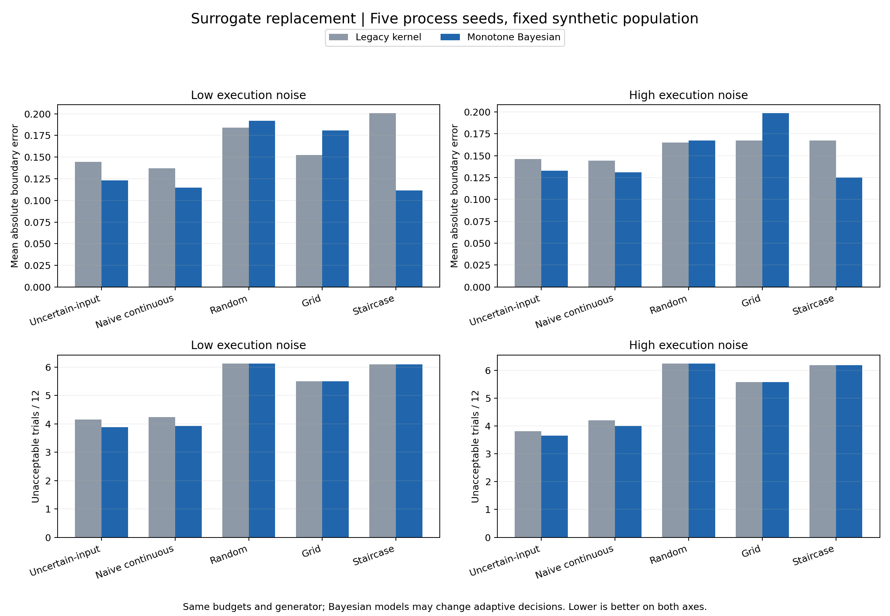
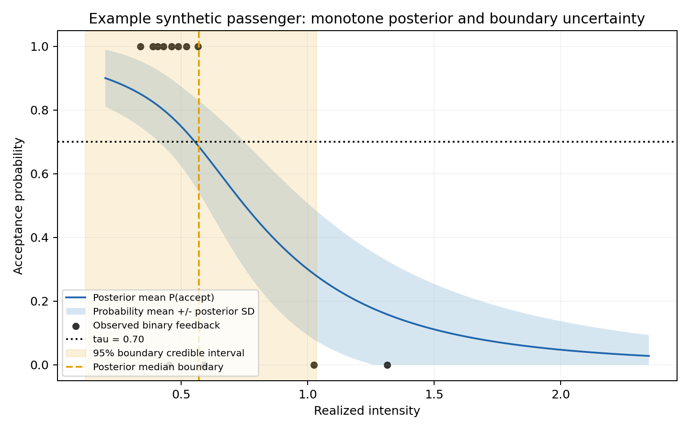

# 单调贝叶斯二元反馈模型：实现、验证与前后比较

日期：2026-11-04。全部结果来自合成乘客。旧版本基线 `e071a7a` 的边界定义已修正；本次比较不混入上一轮指标口径变化。

## 结论

代理模型已从 kernel 平滑与手工不确定性分数，替换为有明确 Bernoulli 似然、单调约束、先验和参数后验的模型。新版本能报告边界区间与外推程度。五过程种子下，两个自适应策略的平均边界误差和不可接受次数都下降；Staircase 的估计改善最明显，Grid 则退步。UncertainInputBO 的误差改善配对区间仍跨零，不能宣称稳定优于旧模型或 NaiveContinuousBO。

选点仍使用历史启发式分数，系数没有重新调参；没有实现严格的信息增益优化、uncertain-input GP-BO 或 SafeOpt 保证。

## 模型与边界

对实测运动强度 m 和二元反馈 y：

```text
y | m,b,k ~ Bernoulli(sigmoid(exp(k) * (b-m)))
b ~ Normal(1.2, 0.75²), truncated to [-1.5, 4.0]
k ~ Normal(log(4), 0.7²), truncated to [log(0.25), log(40)]
B_tau = b - logit(tau) / exp(k)
```

每条参数曲线随强度单调递减，所以后验均值也单调。二维梯形积分网格为 121 × 61；似然在 log 空间计算并归一化。先验是显式的尺度假设，未读取真实乘客参数或真人标签，也不是已学成的群体先验。Bernoulli-logit 形式参照 [Stan 官方说明](https://mc-stan.org/docs/2_27/stan-users-guide/logistic-probit-regression-section.html)；单调参数化、先验、网格及决策规则是本项目的选择。

概率 SD 是不同后验曲线之间的波动，区别于二元反馈自身的 `sqrt(p*(1-p))`。边界点估计是 B_tau 后验中位数，区间为等尾 95% 可信区间，未裁剪到测试范围。无反馈、全接受、全拒绝和边界超出观测范围都有标记；另记录观测范围之外的后验质量和网格边缘质量。超范围估计受先验影响，不能理解为已在该范围取得数据。

真值继续使用含反馈噪声混合与当前 carryover 的 `criterion_boundary_tau`。拟合模型没有获得隐藏噪声率或 carryover 参数，因此它对现有生成器并不完全正确设定。新旧模型用相同真值评分。

## 五种子完整自适应比较

每个噪声级别：同一固定合成人群 24 人、每人每策略 12 次、5 个过程种子。误差单位为项目的标量运动强度；变化为新减旧，负数表示降低。配对区间是在五个种子差值上计算的 95% t 区间，未作多重比较校正，不含人群抽样不确定性。

| 执行噪声 | 策略 | 旧误差 | 新误差 | 变化的 95% 配对区间 | 不可接受次数：旧 → 新 |
|---|---|---:|---:|---|---|
| 低 | UncertainInputBO | 0.1444 | 0.1233 | [-0.0469, 0.0048] | 4.150 → 3.883 |
| 高 | UncertainInputBO | 0.1460 | 0.1327 | [-0.0382, 0.0116] | 3.808 → 3.650 |
| 低 | NaiveContinuousBO | 0.1369 | 0.1148 | [-0.0415, -0.0028] | 4.242 → 3.925 |
| 高 | NaiveContinuousBO | 0.1444 | 0.1310 | [-0.0363, 0.0096] | 4.200 → 4.000 |
| 低 | RandomContinuous | 0.1841 | 0.1920 | [-0.0350, 0.0508] | 6.125 → 6.125 |
| 高 | RandomContinuous | 0.1649 | 0.1673 | [-0.0325, 0.0372] | 6.242 → 6.242 |
| 低 | GridContinuous | 0.1522 | 0.1808 | [0.0107, 0.0465] | 5.508 → 5.508 |
| 高 | GridContinuous | 0.1675 | 0.1985 | [0.0119, 0.0501] | 5.575 → 5.575 |
| 低 | Staircase | 0.2006 | 0.1116 | [-0.1174, -0.0607] | 6.100 → 6.100 |
| 高 | Staircase | 0.1673 | 0.1249 | [-0.0770, -0.0078] | 6.183 → 6.183 |

UncertainInputBO 平均误差下降 14.6% / 9.1%，不可接受次数下降 6.4% / 4.2%。后者的变化区间为低噪声 [-0.4553, -0.0780]、高噪声 [-0.2971, -0.0195] 次。Staircase、Random、Grid 的反馈轨迹不受代理模型影响，误差变化来自最终估计；两个自适应策略还包含选点改变的影响。



完整数值及累计不适变化见 [paired_seed_effects.csv](../results/monotone_bayes_20261104/paired_seed_effects.csv)。新模型条件于实测强度的 prequential Brier 分数并未普遍改善：UncertainInputBO 低/高噪声从 0.20694/0.18829 降至 0.20498/0.18669，但配对区间均跨零；三个固定策略的平均 Brier 均增大。“有合法后验”不等于“所有概率预测都更准确”。

## 相同反馈重放与区间

另用上一版扩展仿真的 240 条完整历史分别拟合两个模型，固定实测强度和反馈，隔离估计器变化。这里只包含扩展版各噪声一个过程种子。UncertainInputBO 低噪声误差 0.1067 → 0.0924，高噪声 0.1086 → 0.1225；Staircase 低/高均改善，Grid 均退步。这批重放的十组平均 Brier 都变差，说明完整自适应运行中较低的 Brier 也受到采样位置改变影响。见 [same_history_summary.csv](../results/monotone_bayes_20261104/same_history_summary.csv)。

| 策略 | 低噪声区间平均宽度 / 真值覆盖率 | 高噪声区间平均宽度 / 真值覆盖率 |
|---|---|---|
| UncertainInputBO | 0.993 / 98.3% | 0.959 / 98.3% |
| NaiveContinuousBO | 0.991 / 97.5% | 1.014 / 100.0% |
| RandomContinuous | 1.178 / 94.2% | 1.119 / 95.0% |
| GridContinuous | 1.073 / 94.2% | 1.105 / 92.5% |
| Staircase | 1.147 / 98.3% | 1.090 / 95.8% |

这是有限合成样本的经验覆盖率。12 次反馈后的区间仍宽；高覆盖不能单独证明估计足够精确。旧模型没有后验区间，因此不为它构造可比的“95% 区间”。



概率带是均值 ± 后验 SD，并非 95% 概率带；橙色区域才是边界的 95% 可信区间。

## 数值、先验与敏感性

- 240 个扩展版最终后验逐个与 241 × 121 加密网格比较：边界中位数最大差 0.00597，下/上区间端点最大差 0.01329/0.00711，概率最大差 0.0000402，全部通过预设精度阈值。插值另有直接积分对照测试。细小场景差异不宜作确定排序。
- 默认后验最大网格边缘质量 0.162%。这提示截断是否活跃，不是被截掉尾部质量的上界。
- 同 240 条新历史，把先验 SD 放宽到 b=1.0、k=1.0：边界平均绝对移动 0.03149，最大 0.35038；平均误差 0.15429 → 0.17454。先验影响大于积分误差。本检查固定历史，未优化先验或重跑宽先验决策策略。
- 从本模型实际有限网格先验抽取参数，做 100 次独立、各 12 次反馈的内部 prior-predictive 检查：95% 区间覆盖 91/100。样本较少，不能宣布已校准到 95%，也不是对真人或失配生成器的保证。
- 旧模型重跑 80 行审计指标与修正基线在 1e-12 内一致；扩展版三个固定策略共 1,728 条轨迹的命令、强度、反馈、不适和真实接受概率一致。

六个敏感性场景各一个种子。以 UncertainInputBO 为例：

| 场景 | 旧误差 → 新误差 | 不可接受次数：旧 → 新 |
|---|---|---|
| tau=0.50 | 0.1501 → 0.1207 | 5.625 → 5.958 |
| tau=0.80 | 0.2181 → 0.1714 | 3.208 → 3.000 |
| feedback_noise=0.02 | 0.1002 → 0.0879 | 3.917 → 3.750 |
| feedback_noise=0.14 | 0.1572 → 0.2302 | 4.333 → 4.042 |
| 已知执行 bias=0.15 | 0.1611 → 0.1748 | 4.750 → 4.333 |
| 时间效应开启 | 0.1244 → 0.1220 | 4.625 → 4.042 |

高反馈噪声下误差增加，已知偏差场景区间覆盖仅 87.5%。这些是稳健性工作的线索；一个种子的结果不能确立因果机制。生成器带 lapse 和时间效应而推断模型为静态 logistic，是已知设定差异。

## 下一步

先拆开执行分布的真实参数和算法估计参数，并加入独立人群种子，再评估未知偏差/误设。之后考虑带 lapse 或动态项的模型与信息增益选点，同时检验先验敏感性。短序列应以误差、暴露、区间宽度和覆盖共同评估，避免只为降低单个指标调参。

复现命令见 [README](../README.md)，检查明细见 [验证报告](2026-11-04-monotone-bayes-verification.md) 和 [validation_summary.json](../results/monotone_bayes_20261104/validation_summary.json)。
